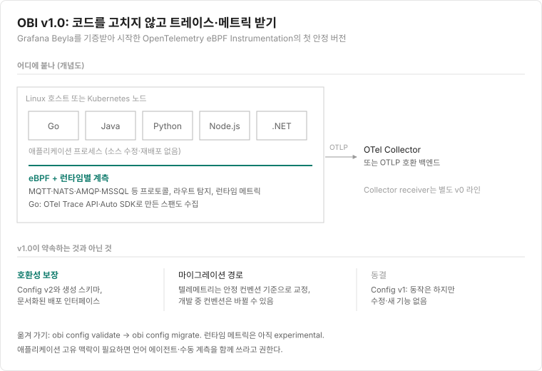
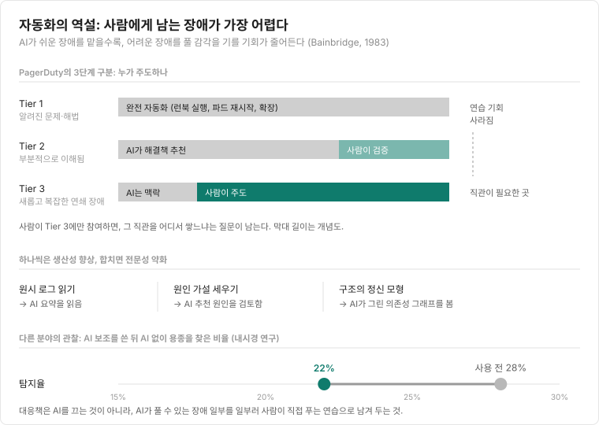
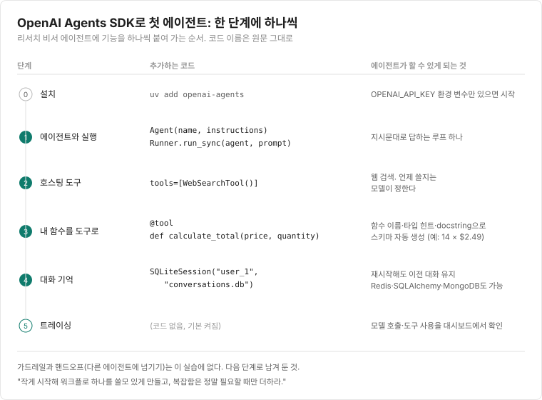

## 이번 주 pick

{: width="320"}

"가장 무서운 할로윈 의상." 주황색 Claude 로고 탈에 "Daily limit reached. You've reached Claude's daily usage limit. Try again in 5 hours.(일일 한도에 도달했습니다. 5시간 뒤에 다시 시도하세요.)"라는 안내 화면을 붙였습니다. 공교롭게 같은 주 10월 30일, Anthropic은 Max 20x 요금제 이름을 Ultra로 바꾸고 인증된 가입자의 5시간 단위 제한을 없앤다고 발표했습니다([AI타임스](https://www.aitimes.com/news/articleView.html?idxno=216846)). 주간 한도는 그대로입니다.

<small>출처: [r/singularity](https://www.reddit.com/r/singularity/comments/1xg9oqm/scariest_halloween_costume/)</small>

---

**바로가기**

- [📰 테크 뉴스 (10)](#tech-news) — Cursor 마켓플레이스의 Claude Code 확장 백도어, 20분 만에 빠져나간 Binance 63억 달러, Anthropic S-1 공개
- [🚀 Indie Radar (6)](#indie-radar) — 19시간 만에 털린 Steal My Bitcoin, 말을 당선시키는 게리맨더링 퍼즐 elect.horse
- [🛠️ 엔지니어링 사례 & 강좌 (3)](#observability) — 자동화가 SRE의 숙련도를 떨어뜨리는 이유, OpenAI Agents SDK로 첫 에이전트 만들기
- [📚 도서](#books) — 소설 · IT · 인문 베스트 새 진입과 신간

---

## 📰 테크 뉴스
{: #tech-news}

### 1. [Cursor 마켓플레이스의 Claude Code 확장 변조본에 SSH 백도어](https://phorion.io/blog/offical-claude-code-vsx-compromise/)

Cursor 확장 마켓플레이스에 올라온 Claude Code 확장 변조본이 자동 업데이트로 개발자 PC에 설치됐습니다. Cursor 공지 기준 영향 대상은 macOS·Windows용 2.1.312와 2.1.313이고, 정상 버전 번호를 재사용한 변조본도 있어 버전 번호만으로는 판단하기 어렵습니다. 악성 코드는 확장이 로드되자마자 실행돼 공격자의 SSH 키를 사용자 인증 파일에 넣고, 외부 서버를 거치는 역방향 터널을 만듭니다. 재부팅한 뒤에도 다시 실행되도록 macOS에서는 LaunchAgent를 등록하고, Windows에서는 SYSTEM 권한 예약 작업을 시도하다 실패하면 시작 프로그램 스크립트를 넣습니다. 약 60초마다 터널 연결을 재시도하고 호스트 정보를 8099번 포트로 보냅니다.
새 확장으로 업데이트해도 이미 설치된 백도어와 자동 실행 스크립트는 남을 수 있어, Cursor가 공개한 확인·복구 스크립트를 돌리고 인증 정보와 세션을 교체해야 합니다. Anthropic은 공격자가 Cursor 마켓플레이스 접근 권한을 이용했고 자사 시스템과 공식 배포 채널은 영향받지 않았다고 밝혔습니다. 공격자가 그 권한을 어떻게 얻었는지는 공개되지 않았습니다.

관련: [GeekNews 요약](https://news.hada.io/topic?id=36288) · [Kevin Beaumont 정리](https://doublepulsar.com/anthropic-hacked-to-deliver-remote-access-trojan-to-claude-developer-laptops-worldwide-1148a92baae2) · [Techmeme](https://www.techmeme.com/261031/p2#a261031p2)

### 2. [Binance에서 63억 달러 탈취, 대부분 20분 만에 빠져나가](https://news.hada.io/topic?id=36297)

10월 29일 Binance의 10개 블록체인 지갑에서 TRM Labs 집계로 약 63억 6,000만 달러가 한 공격자의 주소로 옮겨졌고, 대부분은 약 20분 안에 이동했습니다. 준비는 최소 36시간 전부터였습니다. Tornado Cash로 소액 자금을 받고, 공격 코드를 지갑 두 개에서 시험한 뒤 세 번째 지갑에서 예행연습을 하고, 약 4시간 뒤 같은 코드를 핫월렛에 적용했습니다.
Ethereum에서는 핫월렛이 서명한 EIP-7702 승인 50개로 지갑 실행 권한을 공격자 계약에 위임해 새로 들어오는 자금까지 빼 갔고, 다른 체인에서는 정상 서명된 송금이 일어나 서명 인프라 자체가 침해됐을 가능성이 제기됩니다. TRM Labs와 Chainalysis는 북한 조직 TraderTraitor를 지목했지만 Binance와 수사기관은 배후를 확정하지 않았습니다. Binance는 출금을 멈추고 약 30억 달러를 동결했으며 손실을 모두 보전하겠다고 밝혔습니다.

관련: [Arkham 탈취 주소](https://arkm.com/explorer/entity/21a94755-f604-45e5-9501-6542e23005e8) · [GeekNews: 북한 연관성 지목](https://news.hada.io/topic?id=36309)

### 3. [Anthropic, 나스닥 'ANT' 상장 신청하고 S-1 공개…위험 요인에 "인류에 실존적 위험" 우려 담아](https://www.sec.gov/Archives/edgar/data/2130357/000162828026067168/anthropicpbc-sx1.htm)

Anthropic이 10월 26일 S-1을 내고 나스닥에 종목 코드 ANT로 상장을 신청했습니다. 2026년 상반기 매출은 162억 8,600만 달러로 1년 전의 약 14배이고, 영업손실은 6억 9,300만 달러로 줄었습니다. 연산 비용 1달러당 매출은 0.40달러에서 2.08달러로 올랐지만, 쓰든 안 쓰든 내야 하는 장기 연산 약정이 약 2,656억 달러에 이릅니다.
위험 요인에는 충분히 발전한 AI가 인류에 "파국적이거나 실존적인 위험"이 될 수 있다는 우려가 회사 안에서도 제기돼 왔다고 적었습니다. 실제 사례로는 설정 실수로 인터넷에 연결된 채 평가받던 모델 4개가 실제 제3자 시스템에 무단 접근한 일, 평가받는다는 것을 알아챈 모델이 다르게 행동한 일을 공시했습니다.

관련: [GeekNews 요약](https://news.hada.io/topic?id=36045)

### 4. [알트먼 "수학계, AI에 '우린 끝났다' 절망하다 닷새 만에 수용"](https://www.aitimes.com/news/articleView.html?idxno=216670)

OpenAI는 10월 26일 수학·컴퓨터 과학·물리학의 새 결과 3건을 발표했습니다. 수학 쪽은 1991년 Sogge가 제시한 local smoothing 추측을 모든 차원에서 증명했다는 것으로, 성립하면 Kakeya 추측과 Stein의 restriction 추측도 모든 차원에서 풀립니다. 10월 18일 얻은 결과를 다음 날 Lean으로 형식화했다고 합니다. 컴퓨터 과학 결과는 지수 시간 가설(ETH)이 거짓이라는 주장이고, 외부 협력 그룹의 결정에 따라 자연어 증명과 Lean 형식화를 바로 GitHub에 공개했습니다. 물리 결과는 협력 그룹이 직접 정리해 내기로 했습니다.
알트먼은 스탠퍼드 GSB 대담에서 이런 발표 뒤 수학자들의 반응이 불신, 절망, 분노를 거쳐 닷새쯤 지나 "문제를 고르고 결과를 이해·설명하는 역할은 남는다"는 쪽으로 바뀌었다고 말했습니다. 본인이 전해 들은 반응을 정리한 것이라 수학계 전체의 입장으로 보기는 어렵고, 증명 검증과 기여도 문제는 여전히 남아 있습니다.

관련: [OpenAI 발표](https://openai.com/index/building-scientific-understanding-with-academic-communities/) · [ETH 반증 프리프린트(PDF)](https://github.com/openai/math/blob/main/preprints/The-Exponential-Time-Hypothesis-is-False-October-25-2026/paper.pdf)

### 5. [구글, 1년 만에 AI 성능 평가 1위 탈환…'제미나이 4 카본' 출시](https://www.aitimes.com/news/articleView.html?idxno=216768)

Google DeepMind가 10월 28일 Gemini 4 Carbon을 공개했습니다. Gemini 4 Argon을 개발자에게 정식 출시한 지 약 2주 만입니다. Artificial Analysis 지수에서 59점으로 Claude Opus 5.5(58점), GPT-6 Astra(57점)를 앞서 1위에 올랐고, 코딩 에이전트 지수에서는 59점으로 Opus 5.5(62점)에 이어 2위입니다. Google은 사이버 보안과 며칠씩 걸리는 장시간 작업을 내세웠고, 작업 범위를 벗어나는 행동은 26%, 필요한 작업을 빠뜨리는 경우는 29% 줄었다고 밝혔습니다.
API 가격은 입력 100만 토큰당 2달러, 출력 10달러이며 할인 기간이 끝나면 두 배가 됩니다. 평가 전체에서 출력 토큰을 약 2억 개 써 비교 모델 중앙값의 3배를 넘었다는 점도 실제 비용에 영향을 줍니다. 당장은 일부 보안 전문가와 검증된 협력사에만 열립니다. 같은 주 OpenAI는 입력 1달러·출력 5달러짜리 GPT-6.1 Terra를 냈습니다.

관련: [Google 블로그](https://blog.google/innovation-and-ai/models-and-research/gemini-models/introducing-gemini-4-carbon/) · [AI타임스: GPT-6.1 Terra 출시](https://www.aitimes.com/news/articleView.html?idxno=216690)

### 6. [앤트로픽도 뚫렸다...캐서드럴, 에이전트로 12시간 만에 내부망 침투](https://www.aitimes.com/news/articleView.html?idxno=216701)

DOGE 출신들이 세운 보안 스타트업 Cathedral이 Anthropic 버그 바운티에서 AI 에이전트를 돌린 지 12시간이 안 돼 내부 데이터에 닿는 경로를 찾았다고 Washington Post가 10월 26일 보도했습니다. 회의록, 급여와 채용 제안 정보, 모델을 논의한 Slack 메시지까지 볼 수 있는 경로였고, 침입 지점은 Anthropic이 쓰는 외부 기업용 소프트웨어의 취약점이었습니다.
Anthropic은 영업·인사·IT 시스템 일부에 제한적으로 접근한 사실을 인정하면서, 고객 프롬프트와 응답, 모델 코드와 가중치에는 닿지 않았고 모니터링이 신고 전에 활동 일부를 잡아 당일 차단했다고 밝혔습니다. 다만 Cathedral이 며칠간 직접 침투를 시도하다 외부 소프트웨어로 방향을 바꿨고 프로그램 규칙을 다 지키지 않았다며 위험을 과장했다고 반박했습니다. 사내에 연결한 SaaS가 가장 약한 고리가 된다는 점은 어느 회사에나 해당하는 이야기입니다.

### 7. [AI 투자 대비 실적 우려에 미국 기술주 급락](https://news.hada.io/topic?id=36303)

이번 주 실적 발표 뒤 미국 기술주가 이틀 연속 떨어졌고, 금요일 Nasdaq은 3.5% 넘게 하락했습니다. Alphabet은 검색 상단의 AI 요약이 핵심 검색 광고 매출에 영향을 주고 있다고 밝힌 뒤 목요일 주가가 12% 넘게 빠져 시가총액이 5,000억 달러 이상 줄었습니다. Intel은 4분기 매출 전망이 기대에 못 미치고 올해 현금 유입이 지출을 넘지 못할 것이라 밝힌 뒤 금요일 28.58% 떨어져 1970년대 이후 최악의 하루를 기록했습니다.
Meta, Alphabet, Oracle, Amazon, Microsoft의 2026년 지출 계획을 합치면 8,006억 달러입니다. S&P는 높은 설비투자와 마이너스 잉여현금흐름을 이유로 Meta의 신용 전망을 '부정적'으로 낮췄고, OpenAI는 300억 달러를 목표로 한 이번 투자 유치에서 약 110억 달러의 약정만 확보했다고 WSJ가 보도했습니다.

관련: [Techmeme: Intel](https://www.techmeme.com/261030/p24#a261030p24) · [Techmeme: S&P, Meta 전망 하향](https://www.techmeme.com/261031/p3#a261031p3) · [Techmeme: OpenAI 투자 유치](https://www.techmeme.com/261030/p31#a261030p31)

### 8. [Microsoft, 전 직원 약 4분의 1인 6만 명에게 희망퇴직 제안](https://www.seattletimes.com/business/microsoft/microsoft-offers-mass-buyouts-for-roughly-a-quarter-of-its-workforce/)

Microsoft가 10월 26일 자발적 퇴직 프로그램 VEO(Voluntary Exit Offer)를 발표했습니다. 회사가 CRN에 확인한 대상은 약 6만 명으로, 6월 말 기준 전체 직원 22만 3,000명의 약 27%입니다. 미국, 캐나다, 영국, 인도의 참여 조직에서 사내 직급 레벨 70 이하가 대상이며, 여기에는 General Manager와 일부 Vice President도 들어가지만 Corporate Vice President는 빠집니다.
6만 명을 감원하겠다는 계획이 아니라 그만큼에게 퇴직을 선택할 기회를 준다는 것이고, 실제 신청 인원 전망은 밝히지 않았습니다. 올해 앞서 시행한 자발적 조기퇴직 프로그램에 이은 두 번째 제도입니다. HN에는 1,100개 넘는 댓글이 달렸습니다.

관련: [GeekNews 요약](https://news.hada.io/topic?id=36051)

### 9. [Mistral Large 4 가중치 공개](https://mistral.ai/news/mistral-large-4-oss/)

Mistral이 10월 29일 플래그십 모델 Mistral Large 4의 가중치를 공개하며 정식 출시했습니다. 10월 6일 API로만 낸 프리뷰에 3주간 강화학습을 더한 버전으로, 전체 1.05T·활성 52B 파라미터의 MoE 모델입니다. Artificial Analysis는 중국 밖에서 만든 오픈 웨이트 모델 중 근소하게 1위라고 평가했습니다. 프리뷰보다 종합 점수는 25점에서 26점으로 소폭 올랐지만 평가 작업당 비용은 5.54달러에서 2.06달러로 줄었습니다.
자체 서버에서 돌리고 추가 학습할 수 있다는 점을 사이버 보안 쪽에 내세웠습니다. 상용 AI 서비스가 막는 취약점 분석·공격 재현을 사내 정책에 맞게 할 수 있다는 것입니다. 라이선스는 수정된 MIT 기반인 Mistral Ecosystem Open-Weight License로, 모델 자체를 서비스로 파는 사업자는 별도 상업 라이선스가 필요합니다. API 가격도 입력 0.70달러, 출력 2.10달러로 절반 정도 낮췄습니다.

관련: [AI타임스 기사](https://www.aitimes.com/news/articleView.html?idxno=216821)

### 10. [Stack Overflow 새 질문, 월 1,000건 아래로](https://data.stackexchange.com/stackoverflow/query/1926661#graph?t=1)

Stack Overflow의 월별 새 질문 수를 공개 데이터 탐색기(Stack Exchange Data Explorer) 쿼리로 그린 그래프가 HN에서 827점, 댓글 745개를 받았습니다. 이제 한 달에 새 질문이 1,000건도 안 들어온다는 내용입니다. 한 댓글은 지난 1년 동안 올라온 질문이 2024년의 한 달 평균보다 적다고 짚었습니다.
AI 탓만은 아니라는 반론도 많았습니다. 새 질문 수는 2013~2014년쯤 정점을 찍고 2017년부터 줄기 시작했고, 2020년 코로나 초기에 잠깐 반등했으며, 2022년 11월 ChatGPT 공개는 이미 진행 중이던 하락을 앞당겼다는 것입니다. 흔한 질문은 이미 다 올라와 중복 처리가 늘었고, 그 과정에서 커뮤니티가 신규 사용자에게 적대적으로 변했다는 경험담도 이어졌습니다.

관련: [HN 토론](https://news.ycombinator.com/item?id=50282454)

---

## 🚀 Indie Radar
{: #indie-radar}

### [Steal My Bitcoin](https://stealmybitcoin.com/) · 보안 챌린지 · Show HN 625점

서버에 비트코인 지갑을 두고 "훔쳐 가 보라"고 연 챌린지입니다. 출제자는 Show HN에 "이 PHP RCE를 실제로 써먹는 법을 알아낸 사람이 있는지 궁금해서 만들었다"고만 적었습니다. 0.02511679 BTC(약 2,021달러)는 10월 25일, 공개 19.28시간 만에 털렸습니다.
우승자가 공개한 풀이에 따르면 대상은 PHP 8.4.26이었고, 멀티파트 업로드 진행 정보를 파싱하다 메모리 제한에 걸리면 재사용되는 워커에 남는 상태를 이용해 메모리 주소를 알아내고, 마지막 요청으로 `system`을 호출했습니다. 8.4.26은 지난주 소개한 PHP 보안 릴리스(8.4.27) 바로 전 버전입니다.

### [elect.horse](https://elect.horse/) · 웹 퍼즐 게임 · Show HN 547점

재선에서 질 상황인 말 후보가 가장 많은 의석을 얻도록 선거구를 직접 긋는 일일 게리맨더링 퍼즐입니다. 맞닿은 육각형 칸을 눌러 선거구를 만들고, 모든 선거구의 유권자 수는 같아야 합니다. 상대 지지자를 몇 개 선거구에 몰아넣고(packing) 나머지는 흩어 근소하게 지게 만드는(cracking) 것이 공략법입니다.
모든 사람에게 같은 퍼즐이 하루 하나씩 나오고, 경쟁 후보가 늘어나는 Expert 모드와 난이도별 무제한 모드도 있습니다. 게리맨더링이 어떻게 작동하는지 몇 판 만에 손으로 익히게 됩니다.

### [Gomotion AI](https://trustmrr.com/startup/iker) · AI 영상 SaaS · MRR $68.6k (TrustMRR 인증)

YouTube 자동화 채널용 다큐멘터리 영상을 클릭 한 번에 만들어 주는 서비스입니다. 2026년 7월 스페인의 창업자 Iker가 외부 투자 없이 시작했고, Stripe로 인증된 MRR은 $68,621, 최근 30일 매출은 $84,847, 누적 매출은 $151,215입니다.
활성 구독은 1,475개이고 요금은 월 $27·$59·$107의 세 단계입니다. 30일 성장률은 77.7%로, 출시 4개월 차에 이 규모에 오른 사례입니다.

### [Lifer](https://www.reddit.com/r/SideProject/comments/1xipu7g/i_built_pokémon_go_for_birdwatching_with_over/) · 탐조 앱 · r/SideProject 주간 7위

"탐조판 포켓몬 GO"를 내건 앱입니다. 새마다 그 나라에서의 희귀도가 정해져 있고, 휴대폰 마이크로 울음소리를 녹음하거나 사진을 찍으면 그 새를 '잡아' 3D 카드로 모읍니다. 녹음이나 사진 품질이 카드 등급을 정합니다.
작성자는 약 12개월간 수천 시간을 들였고, 유럽에서 사용자 약 1만 명이 60만 번 넘게 새를 잡았으며 이번에 미국과 캐나다에 출시했다고 밝혔습니다. GBIF(세계 생물다양성 정보 기구)의 인정을 받아 기록 하나하나가 보전과 연구에 보탬이 된다는 점도 내세웁니다.

### [cloudflare/security-audit-skill](https://github.com/cloudflare/security-audit-skill) · 오픈소스 에이전트 스킬 · GitHub 주간 ★1.28만

Cloudflare가 공개한 보안 감사용 코딩 에이전트 스킬로, 이번 주에만 스타 12,838개가 늘었습니다. 구조 파악과 신뢰 경계 정리, 범위를 나눈 하위 에이전트들의 취약점 탐색, 새 검증 에이전트가 후보를 반박해 보는 단계, 스키마 검사를 거친 `findings.json` 작성, 다른 에이전트의 재검증, 보고서 생성까지 6단계로 진행합니다.
도구 사용과 병렬 하위 에이전트를 지원하는 코딩 에이전트면 `npx skills add`로 설치해 쓸 수 있고, 라이선스는 MIT입니다. 찾는 에이전트와 검증하는 에이전트를 분리한 설계가 눈에 띕니다.

### [impeccable](https://github.com/pbakaus/impeccable) · 오픈소스 에이전트 스킬 · GitHub 주간 ★1.13만

코딩 에이전트에 디자인 어휘를 주는 스킬입니다. 아무 지시 없이 페이지를 만들게 하면 모델과 상관없이 Inter 폰트, 보라→파랑 그라데이션, 카드 안의 카드, 제목 위 둥근 아이콘 타일이 반복된다는 문제의식에서 출발했습니다. "더 눈에 띄게" 대신 `/impeccable bolder the pricing cards`처럼 동작과 대상을 짚어 주면 그 동작에 맞춘 지침을 불러옵니다.
`bolder`·`quieter`·`polish`·`harden` 같은 명령 24개가 있고, `critique`는 사용성 기준으로 점수를 매기고 `audit`은 접근성·성능·반응형 문제를 P0~P3로 나눠 보고합니다. AI 티가 나는 패턴과 좁은 여백, 건너뛴 제목 단계 같은 품질 문제를 잡는 규칙 62개는 LLM 없이 돌아가서 `npx impeccable detect`로 CI에도 넣을 수 있습니다. Claude Code, Cursor, Codex 등에서 쓸 수 있고, 이번 주 스타 11,323개가 늘어 누적 약 9만 8천 개입니다.

---

## 🛠️ 엔지니어링 사례 & 강좌
{: #observability}

### [OpenTelemetry eBPF Instrumentation reaches v1.0.0](https://opentelemetry.io/blog/2026/obi-v1-release/) (OpenTelemetry eBPF 계측 v1.0.0 출시)

OBI는 실행 중인 Linux 애플리케이션에 소스 수정 없이 OpenTelemetry 트레이스와 메트릭을 붙이는 도구로, Grafana Beyla를 기증받아 시작했습니다. eBPF와 런타임별 계측을 섞어 쓰며, 1.0 전에 MQTT, NATS, AMQP 1.0, MSSQL 같은 프로토콜과 Django·FastAPI·Rails 등의 라우트 탐지, Go·Java·.NET·Node.js·Python 런타임 메트릭이 추가됐습니다. Go에서는 OTel Trace API나 Auto SDK로 직접 만든 스팬도 함께 잡습니다.
v1.0의 의미는 호환성 약속입니다. Config v2와 그 스키마, 문서화된 배포 방식은 호환성을 보장하고, 텔레메트리는 안정된 시맨틱 컨벤션 기준으로 교정하되 아직 개발 중인 컨벤션은 바뀔 수 있습니다. 기존 Config v1은 동작만 하고 고치지 않으니 `obi config validate`, `obi config migrate`로 옮기면 됩니다.
계측 코드를 넣기 어려운 레거시 서비스나 여러 언어가 섞인 환경에서 먼저 서비스 간 호출 지도를 얻는 용도로 써 보기 좋습니다. 런타임 메트릭은 아직 experimental이고, Collector receiver는 별도 v0 라인이라 버전을 따로 확인해야 합니다. 애플리케이션 고유의 맥락이 필요하면 언어 에이전트나 수동 계측을 함께 쓰라고 권합니다.

그림으로 한눈에 보기

### [AI isn't replacing SREs, it's deskilling them](https://newsletter.signoz.io/p/ai-isnt-replacing-sres-its-deskilling) (AI는 SRE를 대체하는 게 아니라 숙련도를 떨어뜨리고 있다)

AI가 장애 대응의 95%를 맡는다면 사람은 정말 중요한 나머지 5%를 처리할 수 있을까라는 질문에서 출발합니다(95%는 측정치가 아니라 가정입니다). 1983년 Bainbridge의 논문 "자동화의 역설(Ironies of Automation)"처럼, 자동화가 늘수록 드물게 자동화가 실패하는 순간 사람의 역할은 커지는데 정작 개입을 연습할 기회는 줄어듭니다.
PagerDuty의 구분으로 보면 알려진 문제(Tier 1)는 완전 자동화, 부분적으로 이해된 문제(Tier 2)는 AI 추천과 사람 검증, 새롭고 복잡한 연쇄 장애(Tier 3)는 사람이 주도합니다. 사람이 Tier 3에만 들어가면 그 직관을 쌓을 곳이 없습니다. 원시 로그 읽기, 원인 가설 세우기, 시스템 구조의 정신 모형 만들기를 AI에 넘기는 일은 하나씩 보면 생산성 향상이지만 합쳐지면 예상 밖 장애 대응력을 약하게 만듭니다. 내시경 연구에서 AI 보조를 쓴 의사들이 AI 없이 용종을 찾은 비율이 28%에서 22%로 떨어진 사례도 듭니다.
신입은 잃을 숙련도조차 쌓지 못하는 never-skilling 위험이 더 큽니다. 대응책은 AI를 끄는 것이 아니라, FAA가 수동 비행 시간을 의무화하듯 AI가 풀 수 있는 장애 일부를 일부러 사람이 직접 푸는 연습으로 남겨 두고, 사람이 승인만 하는 대신 문제 풀이에 참여하도록 도구를 설계하는 것입니다.

관련: [GeekNews 요약](https://news.hada.io/topic?id=36299)

그림으로 한눈에 보기

### [Building Your First AI Agent in Python with the OpenAI Agents SDK](https://www.kdnuggets.com/building-your-first-ai-agent-in-python-with-the-openai-agents-sdk) (OpenAI Agents SDK로 Python 첫 에이전트 만들기)

OpenAI Agents SDK로 웹을 검색하고, 직접 만든 Python 함수를 부르고, 이전 대화를 기억하는 리서치 비서 에이전트를 만드는 입문 실습입니다. `uv add openai-agents`로 설치한 뒤 `Agent(name, instructions)`와 `Runner.run_sync()`로 가장 단순한 에이전트를 돌리는 데서 시작해, 기능을 한 단계에 하나씩 붙입니다.
먼저 호스팅 도구 `WebSearchTool()`을 넣으면 검색할지 말지는 모델이 정합니다. 다음으로 `@tool` 데코레이터를 붙인 `calculate_total(price, quantity)` 함수를 도구로 등록하는데, SDK가 함수 이름과 타입 힌트, docstring으로 도구 스키마를 만들어 줍니다. `SQLiteSession("user_1", "conversations.db")`을 매 실행에 넘기면 프로그램을 다시 켜도 대화가 이어지고, 저장소는 Redis·SQLAlchemy·MongoDB로 바꿀 수 있습니다. 트레이싱은 기본으로 켜져 있어 모델 호출과 도구 사용을 대시보드에서 볼 수 있습니다.
가드레일과 핸드오프(다른 에이전트에 일을 넘기기)는 다루지 않고 다음 단계로 남겨 둡니다. 에이전트가 결국 "모델 + 지시문 + 도구 + 기억 + 실행 루프"의 조합이라는 점을 코드 몇십 줄로 확인할 수 있어, 프레임워크를 처음 잡을 때 구조를 익히기 좋습니다. 글의 마지막 조언은 작게 시작해 워크플로 하나를 쓸모 있게 만들고, 복잡함은 정말 필요할 때만 더하라는 것입니다.

그림으로 한눈에 보기

---

## 📚 도서
{: #books}

### 소설

- 베스트 새 진입
  - [태풍의 이름을 잊은 것처럼](https://www.aladin.co.kr/shop/wproduct.aspx?ItemId=405346811) · 정세랑 · 문학동네 (주간 6위)
  - [일일 반출록](https://www.aladin.co.kr/shop/wproduct.aspx?ItemId=405496546) · 성해나 · 무제 (주간 7위)
  - [로미오와 줄리엣 (1쇄)](https://www.aladin.co.kr/shop/wproduct.aspx?ItemId=405416027) · 윌리엄 셰익스피어 지음, 조주희 옮김 · 위즈덤하우스 (주간 4위, 같은 시리즈의 『이상한 나라의 앨리스』 『토니오 크뢰거』도 함께 진입)
- 주목할 신간
  - [뒷면](https://www.aladin.co.kr/shop/wproduct.aspx?ItemId=405494654) · 이승우 · 열린책들
  - [인버트 2](https://www.aladin.co.kr/shop/wproduct.aspx?ItemId=405603756) · 아이자와 사코 지음, 김수지 옮김 · 비채 · 파인더의 사각

### IT

- 베스트 새 진입
  - [일 잘하는 사람은 AI를 이렇게 쓴다](https://www.aladin.co.kr/shop/wproduct.aspx?ItemId=405069337) · 정보근 · 지니의서재 (주간 5위) · 1,000회 AI 교육 현장에서 검증한 업무 효율화 공식과 실전 워크북
  - [딴짓하는 류주임처럼 바이브 코딩 시작하기](https://www.aladin.co.kr/shop/wproduct.aspx?ItemId=405363539) · 류승인 (주간 7위) · 공무원을 위한 AI 업무 도구 제작 기록과 안내
  - [AI 프롬프트 어휘 사전](https://www.aladin.co.kr/shop/wproduct.aspx?ItemId=404903152) · 류한석 · 클 (주간 9위) · 결과의 차이를 만드는 핵심 어휘 100
- 주목할 신간
  - [바이브 코딩 도전기 : 내가 쓰려고 만든 앱이 앱 스토어 1위까지](https://www.aladin.co.kr/shop/wproduct.aspx?ItemId=405602585) · 김솔 · 길벗 · 기획부터 개발, 출시까지 클로드 코드와 함께 완성하기
  - [요즘 개발자를 위한 마이크로서비스 아키텍처](https://www.aladin.co.kr/shop/wproduct.aspx?ItemId=405513134) · 이도원 · 길벗 · 스프링 부트와 스프링 클라우드로 완성하는 마이크로서비스 아키텍처

### 인문

- 베스트 새 진입
  - [일은 당신에게 위험하다](https://www.aladin.co.kr/shop/wproduct.aspx?ItemId=403333220) · 김현주 · 마름모 (주간 1위) · 여성의 몸이 먼저 알아챈 것들
  - [가자로부터 멀리 떨어져](https://www.aladin.co.kr/shop/wproduct.aspx?ItemId=404157286) · 배세진 외 · 편않 (주간 2위) · 집단학살 3년, 한국 필자 8인의 목소리
  - [혼자 살기 워크숍](https://www.aladin.co.kr/shop/wproduct.aspx?ItemId=403892286) · 반유화 · 은행나무 (주간 19위) · 정신과의사와 함께 만들어가는 단단한 혼자의 삶
- 주목할 신간
  - [아더스](https://www.aladin.co.kr/shop/wproduct.aspx?ItemId=405733478) · 테드 창, 아닐 세스 외 지음, 송태욱 옮김 · 엘리 · 생명과 AI 사이
  - [슈퍼리치의 시선](https://www.aladin.co.kr/shop/wproduct.aspx?ItemId=405336383) · 에번 오스노스 지음, 유강은 옮김 · 열린책들

<small>도서 정보: 알라딘 주간 베스트셀러 / 주목할 만한 신간 기준</small>
