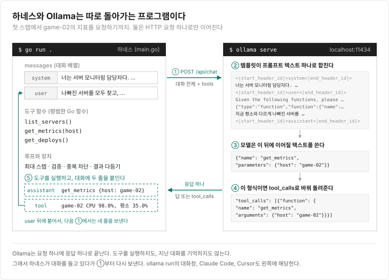
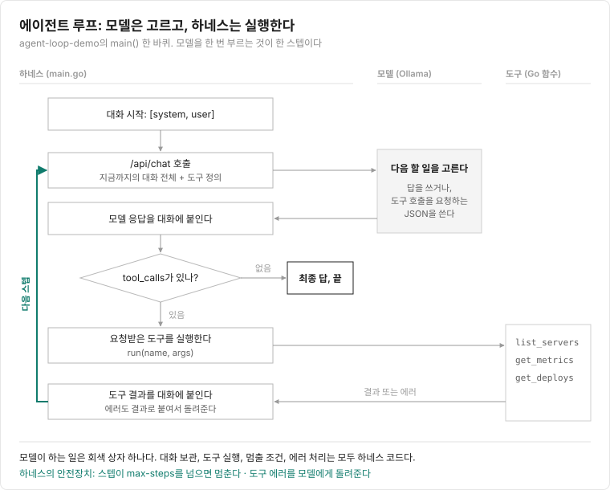
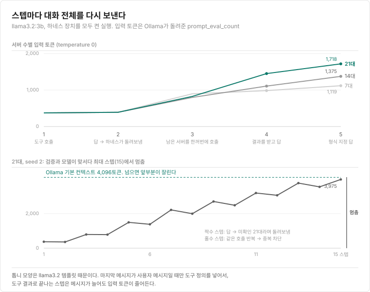

Claude Code나 Cursor 같은 코딩 에이전트는 파일을 읽고, 명령을 실행하고, 결과를 보고 다음 할 일을 정한다. 이때 모델을 감싸서 도구를 실행하고 루프를 돌리는 코드를 하네스(harness)라고 하는데, 모델이 같아도 하네스에 따라 결과가 달라진다. 하네스가 실제로 어떻게 동작하는지 직접 만들어 보면서 알아보려고 한다.

LangChain 같은 프레임워크 없이 Go 표준 라이브러리와 Ollama의 `/api/chat`만 썼다. 과제는 [Jev 글](/normal/2026/09/27/jev-style-alert-with-exaone/)의 가짜 서버 지표를 7대 규모로 줄여 다시 썼다. 모델에게 도구 3개를 주고 "평소보다 나빠진 서버를 찾고 원인을 추정해 줘"라고 시킨다.

- `list_servers`: 서버 이름과 역할 목록
- `get_metrics(host)`: 서버 한 대의 지표 6개(CPU, 메모리, 에러율, 동접, p99, GC 멈춤)의 지금 값과 평소 값
- `get_deploys`: 오늘 있었던 배포·설정 변경 기록

실험 환경은 M1 메모리 8GB 맥북, 모델은 llama3.2:3b다. 예제 코드는 [GitHub 저장소](https://github.com/surinkim/agent-loop-demo)에 있고, 글에 나온 실행마다 다시 돌리는 명령을 README에 적어 두었다.

먼저 에이전트의 루프가 어떻게 생겼는지 보고, 루프만 있는 상태로 모델에게 문제 서버를 찾게 해 본다. 이때 하네스는 모델이 요청한 도구를 실행해 줄 뿐, 서버를 다 확인했는지 검사하거나 같은 호출을 막지는 않는다. 그다음 하네스에 이런 장치를 하나씩 더하면서 결과가 어떻게 바뀌는지 보고, 마지막으로 모두 켠 채 서버를 7대에서 14대, 21대로 늘려 본다.

<br/>

### 먼저 알아야 할 것 1: 모델은 도구를 실행하지 않는다

Ollama에 모델을 올린다고 하네스가 따라붙지는 않는다. Ollama는 모델을 메모리에 올려 두고 `localhost:11434`에서 요청을 기다리는 서버다. 이 글의 하네스인 `main.go`는 그 서버에 HTTP 요청을 보내는 별도 프로그램이고, Ollama가 떠 있는 상태에서 `go run .`으로 실행하면 된다.



Ollama에 대화와 함께 도구 목록(`tools`)을 보내면, 모델은 도구가 필요하다고 판단할 때 답 대신 이런 응답을 돌려준다. 실험에서 모델이 game-02의 지표를 요청할 때 이런 모양으로 왔다.

```json
{
  "role": "assistant",
  "content": "",
  "tool_calls": [
    {"function": {"name": "get_metrics", "arguments": {"host": "game-02"}}}
  ]
}
```

"`get_metrics`를 `game-02`로 불러 달라"는 요청일 뿐이다. 실제로 함수를 부르는 건 하네스다. 하네스가 `get_metrics("game-02")`를 실행하고, 결과를 `tool` 역할 메시지로 대화에 붙여서 다시 모델을 부른다.

모델이 보는 도구 정의도 프롬프트의 일부다. Ollama는 모델마다 정해진 템플릿으로 도구 정의를 프롬프트 텍스트에 끼워 넣는다. 이 템플릿 때문에 입력 토큰이 오르내리는 모습은 뒤의 그림에서 볼 수 있다.

<br/>

### 먼저 알아야 할 것 2: 모델은 이전 호출을 기억하지 못한다

모델은 매 호출이 처음이다. 그래서 하네스는 시스템 메시지, 사용자 질문, 모델의 도구 호출 요청, 도구 결과를 모두 배열에 쌓아 두었다가 호출할 때마다 통째로 다시 보낸다. 도구를 많이 부를수록 다음 호출의 입력이 길어진다.

이 둘을 합치면 에이전트는 루프 하나다. 모델을 부르고, 도구 호출 요청이 있으면 실행해서 결과를 붙이고, 요청이 없으면 그 응답을 최종 답으로 보고 끝낸다.



코드로는 이렇다. 실제 코드에서 로그와 옵션을 뺐다.

```go
messages := []Message{
	{Role: "system", Content: system},
	{Role: "user", Content: question},
}
for step := 1; step <= maxSteps; step++ {
	resp, _ := chat(messages, tools) // 대화 전체를 보낸다
	messages = append(messages, resp.Message)

	if len(resp.Message.ToolCalls) == 0 {
		fmt.Println(resp.Message.Content) // 도구 요청이 없으면 최종 답
		break
	}
	for _, c := range resp.Message.ToolCalls {
		out, err := run(c.Function.Name, c.Function.Arguments) // 평범한 Go 함수
		if err != nil {
			out = "에러: " + err.Error()
		}
		messages = append(messages, Message{Role: "tool", ToolName: c.Function.Name, Content: out})
	}
}
```

이 루프에 덧붙이는 코드, 예를 들어 언제 멈출지, 에러를 어떻게 처리할지, 도구 결과를 어떤 모양으로 줄지 정하는 코드가 하네스의 나머지 부분이다. 아래 실험은 그 장치를 하나씩 켜면서 결과가 어떻게 바뀌는지 본 것이다.

<br/>

### 실험 과제

서버 7대(게임 서버 6대, 배치 서버 1대)의 가짜 지표를 만들고, 그중 3대는 CPU, 메모리, GC 멈춤 같은 값을 평소보다 일부러 높게 설정해 문제가 있는 서버로 만들었다.

| 서버 | 문제 |
|---|---|
| game-02 | CPU 98% (평소 35%) |
| game-04 | 메모리 95% (평소 60%) |
| game-05 | GC 멈춤 450ms (평소 10ms), p99 190ms (평소 100ms). 14:02에 새 버전 배포 |
| batch-01 | 문제 없음. 평소에도 CPU를 91% 쓴다 |

batch-01은 함정이다. CPU 91%만 보고 문제라고 하면 틀린다. game-05는 배포 기록과 연결해야 원인을 맞힐 수 있다. 서버를 늘리기 전까지의 실행은 모두 temperature 0으로, 같은 입력에는 같은 답이 나온다.

<br/>

### 루프만으로 돌려 보기

도구 3개와 위의 루프만 두고, 검증이나 중복 차단 같은 장치는 모두 끈 채로 돌렸다. 최대 스텝(10)과 출력 제한(1,024토큰)은 기본값으로 켜져 있었지만 2스텝 만에 끝나서 걸리지 않았다.

```
[ 1] 메시지  2개, 입력   374토큰, 출력   84토큰,   8.1초
     → get_metrics{"host":"game-07"}
     → get_metrics{"host":"batch-01"}
     → get_deploys{}
     → get_deploys{}
     → get_metrics{"host":"game-08"}
     → get_metrics{"host":"batch-02"}
```

모델은 `list_servers`를 부르지 않고 서버 이름을 짐작했다. 이 과제에는 game-07, game-08, batch-02가 없다. 하네스가 "그런 서버가 없다, list_servers로 이름을 확인하라"는 에러를 돌려줬지만, 모델은 다음 스텝에서 batch-01의 지표를 정리하고 "game-08, batch-02는 존재하지 않습니다"라고 쓴 뒤 끝냈다. 문제 서버는 하나도 찾지 못했다. 2스텝, 21초였다.

에러를 모델에게 돌려주는 대신 바로 프로그램을 끝내게(`-errors stop`) 하면 첫 스텝의 game-07에서 그대로 종료된다. 에러를 돌려주는 기본 설정으로 서버 21대를 돌렸을 때는, 모델이 에러를 받은 다음 스텝에서 `list_servers`를 불렀다.

<br/>

### 하네스 장치를 하나씩 켜기

서버 7대와 도구 3개는 그대로 두고, 하네스 코드에 장치를 하나씩 더해 가며 같은 과제를 다시 돌렸다. 장치마다 하는 일은 표 아래에 적었다.

| 켠 장치 | 결과 | 시간 |
|---|---|---|
| 없음 | 서버 이름을 짐작하다 2스텝 만에 끝남. 문제 서버 0대 | 21초 |
| 검증, 중복 차단 | 남은 6대를 모두 확인. 답이 모든 서버의 모든 지표를 나열하다 출력 제한에 잘림 | 75초 |
| + 변화율 표시 | game-02 CPU를 "+180%, 크게 나빠짐"으로 읽음. 여전히 전부 나열하다 잘림 | 87초 |
| + 답 형식 지정 | JSON으로 답했지만 정상인 game-06을 넣고, game-05를 두 번 넣음 | 118초 |
| + 나빠진 지표만 돌려줌 | 3대를 지표까지 정확히 찾음. batch-01 함정도 피함 | 33초 |

#### 검증

모델이 답을 내려고 하면, 하네스가 `get_metrics`로 확인하지 않은 서버가 남았는지 본다. 남았으면 답을 버리고 "아직 확인하지 않은 서버가 6대 있다: game-01, …"라는 메시지를 붙여 루프로 돌려보낸다. 끝낼지 말지는 모델이 아니라 코드가 정한다. 이 장치를 넣자 모델은 다음 스텝에서 남은 6대를 한꺼번에 불렀다.

#### 중복 차단

같은 도구를 같은 인자로 다시 부르면 실행하지 않고 "이미 받은 결과를 보라"고 돌려준다. 첫 스텝에서 모델은 `get_deploys`를 한 응답에 두 번 불렀다.

#### 출력 제한

Ollama 옵션 `num_predict`로 한 번의 출력을 1024토큰으로 막았다. 제한을 두기 전, Jev 글의 서버 21대 시나리오로 돌렸을 때 모델이 없는 서버 game-21부터 game-51까지 지어내며 한 스텝에 7,542토큰을 쓰고 402초가 걸린 적이 있다. 이때는 입력 3,906토큰에 출력이 더해져 Ollama 기본 컨텍스트 4,096토큰을 넘었기 때문에, 앞부분이 잘린 영향도 섞여 있다.

#### 변화율 표시

`get_metrics` 결과에 `(+180%) ← 크게 나빠짐`을 붙였다. 모델은 이 표시를 읽긴 했지만, 답을 쓸 때는 정상 지표까지 모두 옮겨 적었다.

#### 답 형식 지정

루프가 끝나면 같은 대화에 "평소보다 크게 나빠진 서버만 골라라"를 한 번 더 묻는다. 이때 Ollama의 `format`에 JSON 스키마를 주면 모델은 그 형식으로만 출력한다. 형식은 지켰지만 내용은 틀렸다. 정상인 game-06이 들어갔고, 나빠지지 않은 지표까지 metrics에 담겼다.

```json
{"cause": "모름", "host": "game-06",
 "metrics": ["CPU 사용률: 33.7% (-4% 감소)", "메모리 사용률: 62.0% (+3% 증가)", "응답시간 p99: 97.8ms (-2%)", ...]}
```

#### 나빠진 지표만 돌려주기

앞의 장치까지는 `get_metrics`가 지표 6개를 모두 돌려줬고, 어느 지표가 문제인지는 모델이 골라야 했다. 게임 서버 game-02를 물으면 이런 결과가 갔다(변화율 표시를 켠 상태).

```
game-02 (game)
- CPU 사용률: 지금 98.0%, 평소 35.0% (+180%) ← 크게 나빠짐
- 메모리 사용률: 지금 57.7%, 평소 60.0% (-4%)
- 요청 에러율: 지금 0.1%, 평소 0.1% (+4%)
- 동시 접속자: 지금 4831명, 평소 5000명 (-3%)
- 응답시간 p99: 지금 103.1ms, 평소 100.0ms (+3%)
- GC 멈춤 시간: 지금 9.7ms, 평소 10.0ms (-3%)
```

모델은 여기서 CPU 한 줄만 골라내면 되는데, 정상인 나머지 다섯 줄까지 답에 옮겨 적었다. 답 형식을 지정한 실행에서는 정상인 game-06까지 문제 서버로 넣었다.

그래서 고르는 일을 도구 코드로 옮겼다. `get_metrics`가 평소 값과 비교해 나쁜 방향으로 50% 넘게 변한 지표만 돌려주고, 그런 지표가 없으면 정상이라고 한 줄만 쓴다. 모델에게 가는 결과는 이렇게 바뀐다.

```
game-02 (game)
- 크게 나빠짐: CPU 사용률 지금 98.0%, 평소 35.0% (+180%)

game-06 (game)
- 모든 지표가 평소와 비슷하다. 정상.
```

모델이 숫자를 비교할 필요가 없어졌다. Jev 글에서 2.4B 모델이 숫자 표를 보고 멀쩡한 서버까지 "주의"로 판정해서 했던 처리와 같다. 이렇게 하자 5스텝, 33초 만에 game-02(CPU), game-04(메모리), game-05(p99, GC)를 정확히 찾았다.

다만 원인은 세 대 모두 "모름"이었다. game-02와 game-04는 근거가 없으니 맞는 답이지만, game-05는 배포 기록이 있는데도 연결하지 못했다.

<br/>

### 서버가 늘어나면

같은 장치를 모두 켠 채로 문제 서버 3대는 그대로 두고 정상 서버만 늘렸다. 이번에는 temperature를 0.7로 두고 seed를 바꿔 세 번씩 돌렸다. temperature가 0이면 같은 입력에 늘 같은 답이 나와서, 한 번의 성공이 우연인지 알 수 없다. 0.7로 두면 실행마다 답이 달라지고, seed는 그 무작위를 고정하는 값이라 같은 seed로 돌리면 같은 결과가 다시 나온다.

| 서버 수 | seed | 찾음 (3대 중) | 잘못 넣은 서버 | game-05 원인 | 시간 |
|---|---|---|---|---|---|
| 7대 | 1 | 3 | 없음 | 모름 | 58초 |
| 7대 | 2 | 3 | 없음 | 배포 | 35초 |
| 7대 | 3 | 3 | 없음 | 모름 | 39초 |
| 14대 | 1 | 2 | 11대 | 모름 | 47초 |
| 14대 | 2 | 2 | 없음 | 배포 | 44초 |
| 14대 | 3 | 2 | 없음 | 모름 | 55초 |
| 21대 | 1 | 3 | game-17 | 모름 | 152초 |
| 21대 | 2 | 답 없음 (최대 스텝 15) | - | - | 160초 |
| 21대 | 3 | 3 | 없음 | 모름 | 70초 |

7대에서는 세 번 모두 3대를 찾았고 정상 서버를 넣지 않았다. 14대와 21대에서는 결과가 실행마다 크게 달랐다. 21대 seed 3은 7대만큼 정확했지만, 14대 seed 1은 정상 서버 11대를 넣었다. 서버가 늘면 정확도가 조금씩 떨어진다기보다 결과를 믿을 수 없게 됐다. 크기마다 세 번뿐이라 몇 대부터 그렇다고 말하기는 어렵다.

21대 seed 2는 끝내 답을 내지 못했다. 모델이 `get_metrics`에 서버 이름 대신 `"all"`을 넣었고, 그다음에는 서버 21대의 이름을 배열이나 문자열 하나로 묶어 넣었다. 그 뒤로는 답을 내려 하면 검증이 "미확인 21대"라며 돌려보내고, 모델은 같은 호출을 반복해 중복 차단에 걸렸다. 이 일이 반복되다 최대 스텝 15에서 하네스가 실행을 멈췄다.



서버가 늘수록 도구 결과가 대화에 쌓여 입력이 길어진다. temperature 0 기준으로 마지막 호출의 입력은 7대에서 1,119토큰, 21대에서 1,718토큰이었다.

<br/>

### 결과

이번 실험에서 모델이 한 일은 매 스텝 다음 호출을 고르고 마지막에 답을 쓰는 것뿐이었다. 서버 목록을 모두 확인했는지, 언제 끝낼지, 같은 호출을 다시 실행할지, 출력을 얼마나 허용할지, 답을 어떤 형식으로 받을지는 모두 하네스 코드가 정했다.

3B 모델로 정답을 낸 건 숫자 비교를 도구 쪽으로 옮긴 뒤였다. 서버 7대에서는 seed를 바꿔도 세 번 모두 문제 서버 3대를 찾았지만, 14대와 21대에서는 대화에 쌓이는 도구 결과가 늘면서 실행마다 결과가 달라졌다. 같은 모델이라도 하네스 코드를 어떻게 짜느냐에 따라 결과가 달라진다는 것은 이번에 직접 확인할 수 있었다.
