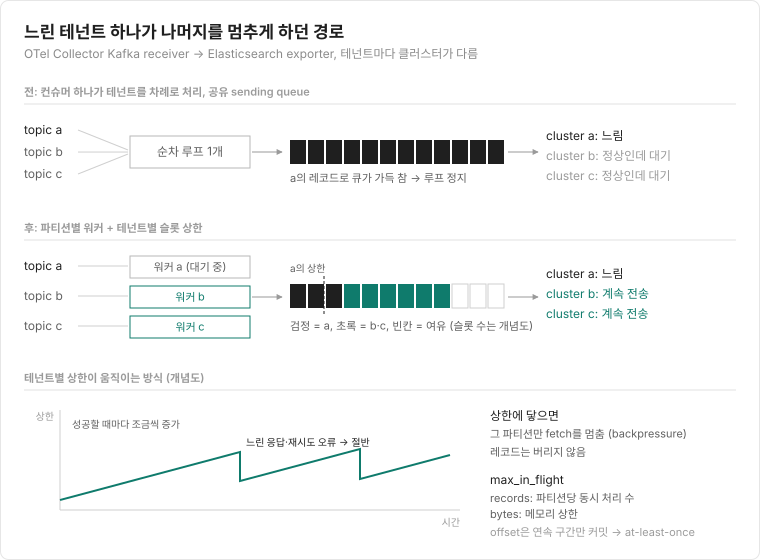
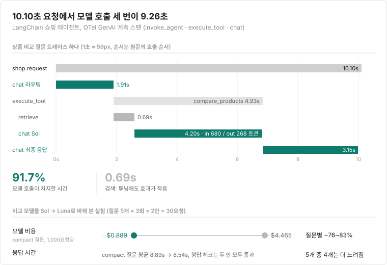

## 이번 주 pick

{: width="320"}

"너는 AI로 독점 소프트웨어를 복제한다. 나는 AI로 오픈소스 소프트웨어를 복제한다. 우린 같지 않다."

<small>출처: [r/ProgrammerHumor](https://www.reddit.com/r/ProgrammerHumor/comments/1xm968l/freesoftwareisabouttobecomemoreinteresting/)</small>

---

**바로가기**

- [📰 테크 뉴스 (10)](#tech-news) — NIKKE PC 런처 공식 CDN 변조, GPT-6 Astra의 가중치 편집, 화면만 보고 재구현하는 Craft Anything
- [🚀 Indie Radar (6)](#indie-radar) — 소리 없이 입 모양으로 입력하는 Subvocal, MRR $54.7k AI 사진 앱 Boothie
- [🛠️ 엔지니어링 사례 & 강좌 (2)](#observability) — OTel Kafka receiver의 테넌트 격리, OpenTelemetry로 본 AI 에이전트 지연
- [📚 도서](#books) — 소설 · IT · 인문 베스트 새 진입과 신간

---

## 📰 테크 뉴스
{: #tech-news}

### 1. [NIKKE PC 런처, 공식 CDN의 JavaScript 변조로 원격 제어 에이전트 설치](https://gist.github.com/MotherSphere/d6c049a09ba8ac3085c51ee9df24a4e5)

Level Infinite가 운영하는 CDN의 공식 JavaScript 파일 4개에 9월 27일부터 공격 코드가 들어가 있었다는 분석이 공개됐습니다. 런처는 이 파일을 정상 구성 요소로 불러오기 때문에, 런처를 실행하면 외부 로더를 거쳐 LuaJIT 기반 원격 제어 에이전트가 내려받아질 수 있었습니다. 이 에이전트는 임의 명령 실행, 화면 캡처, 브라우저 저장 비밀번호·세션, SSH 키, 클라우드 토큰, 암호화폐 지갑 수집이 가능했고, Windows에서는 Chrome 경로를 이용한 DLL 지속성도 설치할 수 있었습니다. Proton으로 런처를 돌린 Linux·Steam Deck 환경도 영향권으로 분석됐습니다. 11월 3일 변조 파일 3개가 교체됐지만 일부 CDN 엣지는 오래된 사본을 계속 내보냈고, 공격자가 CDN에 쓰기 권한을 얻은 경로와 운영사의 공식 조사 결과는 아직 나오지 않았습니다. 분석자는 공식 확인 전까지 런처를 실행하지 말고, 실행한 적이 있다면 자격 증명부터 폐기·재발급하라고 권합니다.

관련: [GeekNews](https://news.hada.io/topic?id=36571)

### 2. [GPT-6 Astra, Qwen 가중치를 직접 고쳐 수학 점수 7.9% → 48.1%](https://rikiyat.github.io/blog/weight-space-programming/)

MIT CSAIL 연구진이 GPT-6 Astra에게 신경망 가중치를 읽고 쓰게 한 실험 묶음을 공개했고, HN에서 이번 주 가장 많은 점수(2,957점)를 받았습니다. 가장 화제가 된 실험은 Qwen3.5-0.8B가 수학 문제에서 같은 말을 반복하다 토큰 한도에 걸리는 문제를 고친 것입니다. Astra는 원인을 MLP 15·19층이 쓰는 한 방향으로 좁힌 뒤, 두 층의 출력 열 64개씩에서 그 방향을 빼 가중치 131,072개(모델의 0.016%)를 바꿨습니다. 학습이나 경사 하강 없이 MATH-500은 7.9%에서 48.1%로, GSM8K는 13.8%에서 67.1%로 올랐습니다. 반론도 바로 나왔습니다. Matthew Honnibal은 Qwen 실험이 가중치만 본 게 아니라 Python으로 편집하고 모델을 최대 50번 돌려 본 결과이며, 같은 방법을 Gemma 3에 쓴 실험은 실패했다고 지적했습니다. Simon Willison은 노트북의 Qwen 3.8 27B로 게임 정책 네트워크의 가중치만 보고 어떤 게임인지 맞히게 했는데, 4개 중 3개를 맞혔지만 한 개에 46분~1시간 넘게 걸렸습니다.

관련: [Astra 글이 과장됐다는 반론](https://honnibal.dev/blog/astra-read-write-misleading) · [Simon Willison: 내 노트북의 Qwen도 가중치를 해석한다](https://simonwillison.net/2026/Nov/3/qwen-can-interpret-model-weights/) · [GeekNews](https://news.hada.io/topic?id=36478)

### 3. [Craft Anything, 웹사이트·앱·게임을 분석해 코딩 에이전트로 재구현하는 오픈소스 도구](https://github.com/storytold/craft-anything)

원본과 원하는 결과를 지정하면 분석 → 구현 → 비교 → 개선을 반복해 새 프로젝트를 만들어 주는 Rust 도구입니다. "이 웹사이트를 재현해 줘", "이 게임을 Rust로 만들어 줘" 같은 요청을 받고, 웹사이트는 세 가지 화면 너비에서 레이아웃과 메뉴 동작을 원본과 비교하며 다른 부분을 고칩니다. 기본 Clean room 모드는 원본 코드나 파일을 읽지 않고 스크린샷, 보이는 글자, 배치, 색상만 보고 작업하며, Deep 모드는 바이너리와 코드까지 읽고 Ghidra와 연동해 .NET, Java, Android, Electron, 펌웨어, 게임 파일을 분석합니다. 구현은 사용자의 컴퓨터에 설치된 Claude Code 같은 코딩 에이전트가 맡고, 게임은 Unity·Unreal·Godot로 재구현할 수 있습니다. README는 소유했거나 분석 허락을 받은 소프트웨어에만 쓰고, DRM·로그인·안티치트는 우회하지 않으며, 로고·사진·문구는 권한을 확인하기 전까지 복사하지 않도록 에이전트에 지시한다고 적었습니다. Clean room은 도구가 제공하는 기능의 규칙일 뿐 운영체제 수준의 샌드박스는 아니라는 점도 함께 밝혀 두었습니다. 이미지 편집기 PhotoCraft를 만든 ArtCraft 팀의 프로젝트로, GitHub 별은 1.9만 개를 넘겼습니다.

관련: [GeekNews](https://news.hada.io/topic?id=36730)

### 4. [OpenAI, Linux 커널 로컬 권한 상승 취약점 948개 찾아 익스플로잇과 패치까지](https://openai.com/index/a-thousand-fewer-paths-to-root/)

OpenAI가 출시 예정인 사이버 보안 모델로 Linux 커널 master를 훑어, 후보 2,308개 중 1,724개를 KASAN 가상 머신에서 재현하고 고유한 로컬 권한 상승(LPE) 948개의 익스플로잇과 패치 후보를 만들었습니다. 전체 API 비용은 1,213,430달러, LPE 하나에 약 1,279달러였습니다. 7월 말 GPT-5.6 Sol로 당시 master를 돌렸을 때는 166개였습니다. 스캔 후 수동 분석을 마치기까지 10일 동안 그중 61개는 이미 업스트림에서 고쳐졌고, OpenAI는 치명적인 것부터 보고하는 중입니다. 같은 주에 Robert Haas는 LLM으로 찾은 버그 제보가 몰리면서 PostgreSQL 19 출시가 11월로 밀렸고, 출시 준비 브랜치로의 백포트 커밋이 1년 전보다 60% 넘게 늘었다고 썼습니다.

관련: [Postgres 19 is late, and it's AI's fault](http://rhaas.blogspot.com/2026/10/postgres-19-is-late-and-its-ais-fault.html) · [GeekNews: OpenAI 948개](https://news.hada.io/topic?id=36634) · [GeekNews: Postgres 19](https://news.hada.io/topic?id=36491)

### 5. [Claude Code가 웹 검색 요청의 User-Agent에 사용자 이메일을 넣는다는 버그 리포트](https://github.com/anthropics/claude-code/issues/107757)

Claude Code 2.1.318을 쓰는 사용자가 웹 검색 중 User-Agent 헤더에 자신의 이메일이 허락 없이 들어갔고, 그 뒤 하루 수십 통의 스팸을 받았다고 보고했습니다. HN에서 1,570점을 받으며 퍼졌습니다. 토론에서는 SEC나 Wikimedia처럼 자동화 클라이언트에 연락처를 요구하는 사이트가 있어서 에이전트가 이메일을 넣는 경우가 있으니, 넣기 전에 사용자에게 물어야 한다는 의견이 나왔습니다. Anthropic 쪽 기여자는 11월 6일 v2.1.317부터 이런 동작을 막는 내장 mod `cc-plugin-privacy`를 기본으로 켰고 `/plugins`에서 끌 수 있다고 답했습니다. 다만 신고자의 버전이 그보다 높아서, 수정 뒤에도 재현되는지는 스레드에서 정리되지 않았습니다.

### 6. [Postman 데스크톱이 Codex·Claude Code 플러그인과 CLI를 말없이 설치](https://github.com/postmanlabs/postman-app-support/issues/14370)

macOS용 Postman 12.33.4를 연 사용자가 로그에서 Codex와 Claude Code용 Postman 플러그인, 원격 MCP 서버 설정, `~/.local/bin`의 Postman CLI가 자동 설치된 기록을 찾았습니다. Codex 쪽에는 세션 시작 훅이 붙어, 대부분의 API 작업에서 Postman 스킬을 먼저 읽으라고 에이전트에게 지시했습니다. HN 제목은 API 데이터를 공유하려 한다고 했지만, 신고자는 데이터 유출이 아니라 원치 않는 설정과 지시문 변경을 문제 삼았습니다. Postman은 11월 5일 설치 흐름에 안내가 있었다고 해명한 뒤, 같은 날 변경을 되돌리고 opt-in 방식으로 다시 설계하겠다고 밝혔습니다.

### 7. [앤트로픽, 클로드로 기존 게임 복제 금지…정상 작업까지 차단 논란](https://www.aitimes.com/news/articleView.html?idxno=216862)

10월 27일 X 사용자가 Claude Code에서 게임 개발 관련 새 규칙을 발견했고, Anthropic은 30일 다른 사람의 특정 게임을 재현하지 않도록 Opus 5.5 프롬프트에 두 문장을 추가했다고 확인했습니다. 독창적인 게임, 장르 게임, 사용자 자신의 디자인으로 만드는 게임은 허용 대상이었지만, 개발자들은 게임 메커니즘을 참고한 기능 작업, 자기 게임의 안티치트, 크래시 덤프 분석 같은 작업까지 거절됐다고 보고했습니다. 반발이 이어지자 Anthropic은 11월 4일 지침을 고쳐, 기존 게임을 그대로 복제하는 요청은 계속 막되 단순히 거부하지 않고 같은 장르의 새 게임을 만들자고 제안하도록 바꿨습니다.

관련: [앤트로픽, '클로드' 게임 복제 제한 완화](https://www.aitimes.com/news/articleView.html?idxno=217115) · [GeekNews](https://news.hada.io/topic?id=36384)

### 8. [오픈AI, 12월부터 챗GPT·코덱스 사용량 통합…기존 앱 1월 종료](https://www.aitimes.com/news/articleView.html?idxno=216934)

12월부터 Plus·Pro·Business 요금제에서 ChatGPT와 Codex가 사용량 한도 하나를 같이 씁니다. 두 서비스의 토큰 사용량이 같은 한도에서 빠지고, 차감량은 모델과 작업 복잡도에 따라 다르며, Instant 모델로 하는 일반 채팅은 빠지지 않습니다. Codex는 ChatGPT 데스크톱 앱 안의 별도 작업 공간으로 남고, 맥용 'ChatGPT Classic' 앱은 2027년 1월 30일에 종료됩니다. 이 내용은 OpenAI가 보낸 이메일이 HN에 올라오면서 알려졌습니다. 한쪽을 많이 쓰면 다른 쪽 여유가 줄어드는 구조인데, 전체 사용 가능량이 늘어나는지 줄어드는지는 공개되지 않았습니다.

### 9. ["AI 50개 모아 문명 건설 시켰더니 관료주의에 빠져 실패"](https://www.aitimes.com/news/articleView.html?idxno=216893)

Y Combinator와 Olam Labs 연구진이 마인크래프트 등에서 AI 에이전트 군집을 협업·경쟁시킨 결과를 공개했습니다. GPT-6.1 Sol 에이전트 50개에게 3시간 안에 문명을 세우라고 했더니, 약 5,900개의 메시지를 주고받으며 식량 배급 장부와 승인 절차를 만드는 데 시간을 쓰다 실패했습니다. 밀 재배용 뼛가루를 두고 에이전트 4개가 '단독 비료 운영자'를 정하는 데만 11분이 걸렸고, 첫날 밤 좀비 공격으로 에이전트 22개가 죽은 뒤로는 밤마다 대피소에 모여 활동을 줄였습니다. 경쟁 실험에서는 GPT 에이전트 10개가 Claude Opus 5.5 에이전트 10개와의 Bed Wars에서 6승 3패를 했고, 연구진은 실행 도구를 GitHub에 공개했습니다.

### 10. [Discord, Electron과 React Native를 걷어내고 클라이언트 전체를 Rust로](https://www.theverge.com/news/1027379/discord-ditching-electron-web-app)

Discord CTO Stanislav Vishnevskiy가 데스크톱 앱 전체를 Rust로 옮기고 있다고 밝혔습니다. 데스크톱 UI는 GPUI로 만들고, 모바일은 React Native를 빼되 네이티브 UI는 유지하면서 Rust로 데스크톱과 코드를 공유합니다. 그가 공개한 Windows 클라이언트 화면의 RAM 사용량은 290MB로, 서버 몇 곳만 들어가도 1GB를 넘기는 지금 앱과 차이가 큽니다. Discord는 2018년부터 인프라와 음성 쪽에 Rust를 써 왔고, 전체 전환 시점은 아직 정해지지 않았습니다.

관련: [GeekNews](https://news.hada.io/topic?id=36657)

---

## 🚀 Indie Radar
{: #indie-radar}

### [HackerBooks](https://hackerbooks.org) · 웹 서비스 · Show HN 1,864점

Hacker News 댓글에서 언급된 책을 모아 보여 주는 사이트입니다. 2007~2026년 댓글에서 책 15,704권, 언급 284,808건을 모았고 주제·출간 연대·첫 언급 연도로 거를 수 있습니다. 같은 주에 Karpathy가 HN 추천 영상을 모은 HackerTube를 내놓자, 책·Wikipedia·TV 채널 버전이 연달아 Show HN에 올라왔고 그중 가장 높은 점수를 받았습니다.

### [Subvocal](https://news.ycombinator.com/item?id=50340088) · 웨어러블 · Show HN 840점

소리 내지 않고 입 모양만으로 컴퓨터에 입력하는 안경입니다(YC F26). 안경테에 넣은 안테나가 저전력 전파를 내보내고, 혀·입술·연구개 움직임에 따라 바뀌는 신호를 기반 모델이 텍스트로 바꿉니다. 새 사용자는 문장 20개 정도로 보정하고, 추론은 클라우드에서 돌아 지연은 보통 500ms 미만이라고 합니다. 첫 500대 선주문을 받고 있고 출하는 2027년 1분기 목표인데, 댓글에서는 로컬 추론이 아니면 사지 않겠다는 반응이 가장 많았습니다.

### [Uncracked City](https://uncracked.city) · 추리 게임 · Show HN 127점

실제 도시를 배경으로 한 추리 게임으로, 용의자에게 글이나 음성으로 질문하면 각자의 목소리로 답하고 그중 누군가는 거짓말을 합니다. 찾은 단서를 용의자의 진술에 맞대 거짓을 드러낸 뒤 보고서를 내는데, 기회는 세 번입니다. 파리·도쿄 등 5개 도시의 연습 사건 뒤에 어려운 사건이 이어지고, 앱과 브라우저에서 계정 없이 할 수 있습니다.

### [Boothie](https://trustmrr.com/startup/boothie) · AI 사진 앱 · MRR $54.7k (TrustMRR 인증)

셀카를 올리고 디지털카메라, 필름, 포토부스 같은 스타일을 고르면 그 느낌으로 다시 그려 주는 iOS·Android 앱입니다. 튀르키예의 1인 창업자가 2026년 6월 iOS, 9월 Android로 냈고, TrustMRR 기준 MRR $54,667, 최근 30일 매출 $55,119, 활성 구독 2,313건입니다(RevenueCat 연동). 마케팅 채널은 TikTok 하나로 적혀 있습니다.

### [산사(Sansa)](https://sansatemple.com/) · 웹 메타버스 · r/SideProject 주간 20위

한국 개발자가 만든 브라우저 속 절입니다. 작은 스님이 되어 돌아다니거나 절을 하거나 다른 방문자와 그냥 머무를 수 있고, 채팅은 일부러 없앴습니다. 작성자는 4일 동안 130만 명이 다녀갔다고 제목에 적었고, 댓글에서 수치를 의심하는 반응이 나오자 조회 200만 회를 넘긴 X 게시물을 근거로 들었습니다.

### [T3 Code](https://github.com/pingdotgg/t3code) · 오픈소스 · GitHub 주간 ★1.68만

내 컴퓨터에서 도는 Claude Code, Codex, Cursor, OpenCode 같은 코딩 에이전트를 한 화면에서 다루는 컨트롤 앱입니다. 데스크톱(Electron)·웹·iOS·Android로 나와 있어 휴대폰에서 원격으로 에이전트를 지켜보고 지시할 수 있고, 권한 모드와 여러 계정도 지원합니다. MIT 라이선스이며, 아직 초기라 버그를 예상하라고 적혀 있습니다.

---

## 🛠️ 엔지니어링 사례 & 강좌
{: #observability}

### [Two changes to the OpenTelemetry Kafka receiver that stop one slow tenant stalling the rest](https://www.elastic.co/observability-labs/blog/opentelemetry-kafka-receiver-tenant-isolation) (느린 테넌트 하나가 나머지를 멈추지 않게 한 OpenTelemetry Kafka receiver의 두 가지 변경)

Elastic Cloud의 Collector 하나가 여러 테넌트의 Kafka 토픽을 읽어 테넌트별 Elasticsearch 클러스터로 보내는데, 한 테넌트의 클러스터가 느려지면 정상인 테넌트까지 멈추는 문제가 있었습니다. 원인은 두 겹이었습니다. 와일드카드로 묶인 컨슈머 하나가 모든 테넌트의 레코드를 한 루프에서 차례로 처리했고, exporter의 sending queue는 모든 테넌트가 같이 썼습니다. 느린 테넌트의 레코드가 큐를 채우면 루프가 다음 레코드를 넘기지 못해 전부 멈춘 것입니다. 해결은 파티션마다 워커를 따로 두는 것과, 테넌트별로 큐 슬롯 상한을 두는 limiter processor를 넣는 것이었습니다. 상한은 성공할 때마다 조금씩 늘고 느린 응답이나 재시도 오류가 나면 바로 절반이 되며, 상한에 닿은 테넌트는 자기 파티션의 fetch만 멈춥니다. 파티션 안 동시 처리 수를 늘리는 `max_in_flight`도 추가됐는데, 연속된 구간의 offset만 커밋하기 때문에 장애 뒤 중복은 생길 수 있어도 유실은 없습니다(at-least-once).

그림으로 한눈에 보기

### [Three model calls, 92% of the wait: AI agent observability with OpenTelemetry](https://www.elastic.co/observability-labs/blog/ai-agent-observability-opentelemetry) (모델 호출 세 번이 대기 시간의 92%: OpenTelemetry로 보는 AI 에이전트 관측성)

커피 메이커 쇼핑을 돕는 LangChain 에이전트를 OTel GenAI 계측 라이브러리로 계측해, `invoke_agent`·`execute_tool`·`chat` 스팬에 모델 이름, 토큰 수, 시간을 남긴 사례입니다. 프롬프트와 응답 본문은 `NO_CONTENT` 설정으로 저장하지 않았고, 루트 스팬에 요청별 모델 비용을 속성으로 붙였습니다. 상품 비교 질문 하나의 트레이스는 10.10초였는데, 도구 선택·비교·최종 응답 세 번의 모델 호출이 9.26초였고 검색은 0.69초에 불과해 검색을 튜닝해도 효과가 작다는 게 바로 보였습니다. 비교 모델을 비싼 Sol에서 싼 Luna로 바꿔 보니 질문별 모델 비용은 76~83% 줄었지만, 응답 시간은 5개 질문 중 4개에서 오히려 늘었습니다. 비용과 지연은 따로 재야 하고, 30요청짜리 실험이라 프로덕션 모델을 바꾸기 전에 표본을 늘려야 한다는 점도 글에 적혀 있습니다.

그림으로 한눈에 보기

---

## 📚 도서
{: #books}

### 소설

- 베스트 새 진입
  - [같은 여자끼리](https://www.aladin.co.kr/shop/wproduct.aspx?ItemId=405941025) · 청예 · 오리지널스 (주간 15위)
  - [체스 이야기·낯선 여인의 편지 (먼슬리 클래식)](https://www.aladin.co.kr/shop/wproduct.aspx?ItemId=406237524) · 슈테판 츠바이크 지음, 김연수 옮김 · 문학동네 (주간 17위)
- 주목할 신간
  - [원했지만 여전히 갖지 못한 모든 것](https://www.aladin.co.kr/shop/wproduct.aspx?ItemId=406084015) · 박지영 · 열린책들
  - [경성 활자 미스터리](https://www.aladin.co.kr/shop/wproduct.aspx?ItemId=406156037) · 이미정 · 창비

### IT

- 베스트 새 진입
  - [웹소설 오늘부터 씁니다](https://www.aladin.co.kr/shop/wproduct.aspx?ItemId=404319669) · 정무늬 · 길벗 (주간 1위) · 오늘 써서 내일 파는 실전 작법 (소설·인문 분야에도 함께 진입)
  - [박태웅의 AI 사회](https://www.aladin.co.kr/shop/wproduct.aspx?ItemId=405938207) · 박태웅 · 한빛비즈 (주간 6위) · 전기국가의 거대한 전환점, 다시 쓰는 일과 조직과 국가의 미래
- 주목할 신간
  - [AI 에이전트와 스프링 배치를 활용한 배치 엔지니어링](https://www.aladin.co.kr/shop/wproduct.aspx?ItemId=406178449) · 정상혁 · 위키북스 · 클로드와 코덱스를 감독하는 대용량 배치 처리 지침
  - [실전! AI 프로젝트 완주의 기술](https://www.aladin.co.kr/shop/wproduct.aspx?ItemId=406074738) · 서창호 · 한빛미디어 · 문제 정의부터 데이터·모델·목표 성능·현업 적용까지

### 인문

- 베스트 새 진입
  - [옥희와 상열](https://www.aladin.co.kr/shop/wproduct.aspx?ItemId=404961662) · 임옥희 · 어웨이크 (주간 5위) · 늙음과 공존에 관하여
  - [피폭된 조선](https://www.aladin.co.kr/shop/wproduct.aspx?ItemId=403848228) · 이토 다카시 지음, 배지원 옮김 · 바다출판사 (주간 11위) · 1945 히로시마와 나가사키, 그날 그곳에 우리가 있었다
- 주목할 신간
  - [공부의 종말](https://www.aladin.co.kr/shop/wproduct.aspx?ItemId=405996682) · 로랑 알렉상드르, 올리비에 바보 지음, 조민영 옮김 · 부키 · AI와 지능 외주화 시대, 미래를 위해 어떻게 배워야 하는가
  - [한국괴담록](https://www.aladin.co.kr/shop/wproduct.aspx?ItemId=405940460) · 전혜진 · 동녘 · 처녀귀신부터 나폴리탄까지, 한국 괴담의 모든 것

<small>도서 정보: 알라딘 주간 베스트셀러 / 주목할 만한 신간 기준</small>
