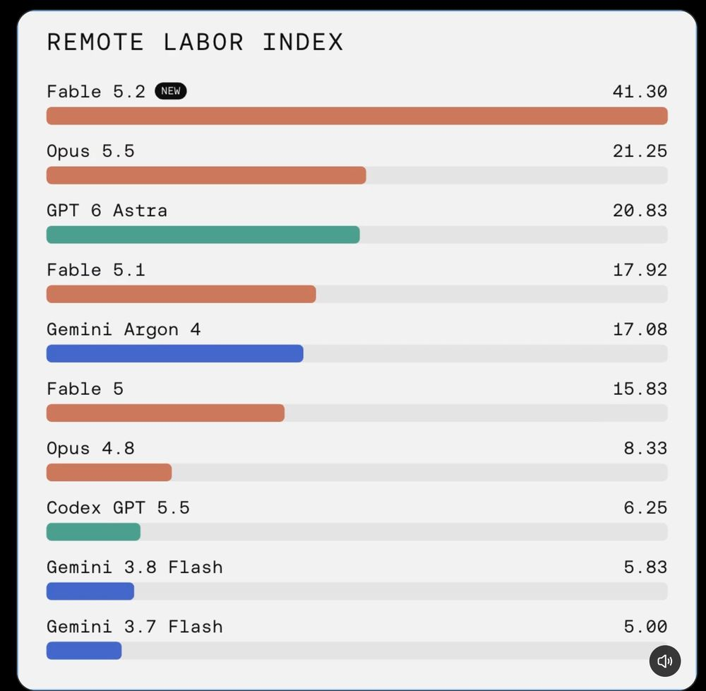
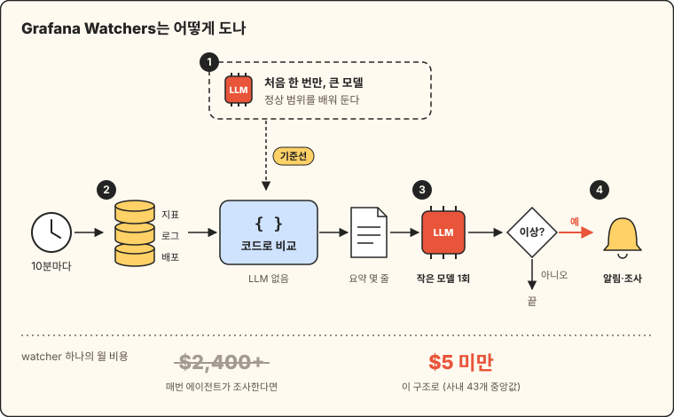
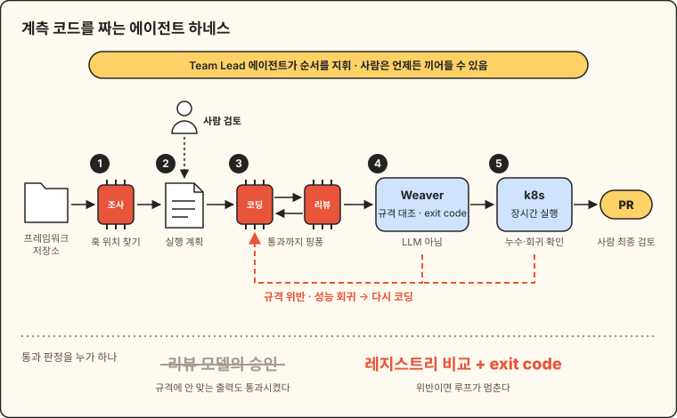
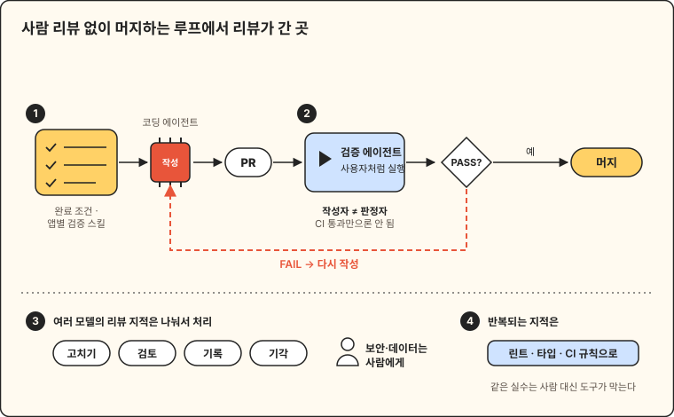

## 이번 주 pick

{: width="420"}

Remote Labor Index(원격 노동 지수)는 Center for AI Safety와 Scale AI가 만든 벤치마크입니다. 프리랜서 플랫폼에서 가져온 실제 프로젝트 240개(23개 분야, 사람이 하면 6,000시간 이상)를 AI 에이전트에게 맡기고, 결과물이 사람 프리랜서의 결과물만큼 괜찮다고 판정된 비율을 점수로 씁니다. 2025년 10월 처음 공개됐을 때 1위는 2.5%였고, Fable 5에서 15.83%, Fable 5.1에서 17.92%였다가 이번 주 Fable 5.2가 41.30%를 기록했습니다. 실제 일감 열 개 중 네 개를 고객이 받아 줄 수준으로 끝낸다는 뜻입니다.

<small>출처: [r/singularity](https://www.reddit.com/r/singularity/comments/1xs9fqh/this_completely_reshapes_the_economy/) · 벤치마크 설명: [RLI 논문](https://arxiv.org/abs/2510.26787)</small>

---

**바로가기**

- [📰 테크 뉴스 (10)](#tech-news) — 젠슨 황 엔비디아 CEO 사임, Fable 5.2와 Gemini 4 Hydrogen, MS 365와 FAA의 대형 장애, Go 17주년
- [🚀 Indie Radar (5)](#indie-radar) — 구독을 피하려고 직접 만든 자수기 앱 ZigZag, 2.5년 만에 MRR $18.2K Glitter AI
- [🛠️ 엔지니어링 사례 & 강좌 (3)](#observability) — Weaver로 판정하는 OTel 계측 하네스, 사람 리뷰 없이 머지하는 Cursor의 검증 루프
- [📚 도서](#books) — 소설 · IT · 인문 베스트 새 진입과 신간

---

## 📰 테크 뉴스
{: #tech-news}

### 1. [젠슨 황, 엔비디아 CEO 사임…주가 장중 14% 급락](https://www.aitimes.com/news/articleView.html?idxno=217348)

엔비디아가 11월 12일 젠슨 황이 사장·CEO·이사회 이사직에서 즉시 물러난다고 발표했습니다. 회사는 사유를 밝히지 않았지만, 중국 정보기관 연계 의혹을 받는 여성과의 관계를 황이 인정·사과한 데 이어 사내 부사장과의 관계가 추가로 보도된 것이 결정타가 됐다는 분석입니다. 임시 CEO는 2013년부터 CFO를 맡아 온 콜레트 크레스, 이사회 의장은 하비 존스가 맡았고, 정식 후임은 내외부에서 찾습니다. 주가는 발표 당일 개장 직후 최대 14.3% 떨어졌고, 10월 초 고점과 비교하면 시가총액 1조 8,000억 달러 넘게 줄었습니다. HN에서 이번 주 가장 많은 점수(4,021점)와 댓글(3,422개)을 받았고, 17일 실적 발표와 미 의회 증언이 다음 고비입니다.

관련: [황이 직원들에게 보낸 편지](https://nvidianews.nvidia.com/news/a-message-to-our-company) · [AP](https://apnews.com/article/nvidia-megaspeed-china-singapore-huang-5403f152a601cf82ce939f1d24fffa0f) · [임시 CEO 체제](https://www.aitimes.com/news/articleView.html?idxno=217350)

### 2. [앤트로픽 '페이블 5.2', AI 성능 평가 1위 탈환…API 가격도 20% 인하](https://www.aitimes.com/news/articleView.html?idxno=217196)

Anthropic이 11월 9일 Claude Fable 5.2와 Mythos 5.2를 공개했습니다. 두 모델은 같은 기반 모델이고, Fable은 사이버보안·생물학 안전장치를 건 일반용, Mythos는 검증된 기관에 일부 제한을 풀어 주는 버전입니다. Artificial Analysis 지능 지수에서 65점으로 Gemini 4 Carbon(60점)을 넘어 1위를 되찾았고, 원격 실무 과제를 얼마나 끝내는지 보는 Remote Labor Index는 Fable 5.1의 17.9%에서 41.3%로 올랐습니다. API 가격은 입력 100만 토큰당 8달러, 출력 40달러로 이전보다 20% 낮아졌습니다. 같은 주 aitimes 인기 기사에는 Fable 5.2 프롬프트 가이드와 전자기기 설계 사례까지 함께 올랐습니다.

관련: [Anthropic 발표](https://www.anthropic.com/claude-fable-and-mythos-5-2) · [GeekNews](https://news.hada.io/topic?id=36896)

### 3. [구글, '제미나이 4 하이드로젠' 출시…상위 모델 '아르곤' 성능 추월](https://www.aitimes.com/news/articleView.html?idxno=217352)

Google이 11월 12일 Gemini 3.8 Flash의 후속인 빠른 실행 모델 Gemini 4 Hydrogen을 내놨습니다. Gemini 4 Carbon을 바탕으로 만들었고, 작업 완료 속도는 기존 경량 모델보다 2.5배 빠르며, Artificial Analysis 지능 지수는 high 설정 51점으로 한 단계 위 모델인 Argon(50점)을 넘었습니다. 가격은 입력 100만 토큰당 1.5달러, 출력 7.5달러로 3.8 Flash의 두 배지만, Flash도 내년 1월부터 같은 가격이 됩니다. 코딩 도구 Antigravity는 복잡한 판단에는 Carbon을, 반복 작업에는 Hydrogen을 자동 배정해 사용량을 평균 24% 줄였다고 밝혔습니다. 같은 주 Carbon도 정식 출시(GA)됐습니다.

관련: [Carbon 정식 출시](https://www.aitimes.com/news/articleView.html?idxno=217249) · [Google 블로그](https://blog.google/innovation-and-ai/models-and-research/gemini-models/introducing-gemini-4-hydrogen/) · [GeekNews](https://news.hada.io/topic?id=37068)

### 4. [구글, 코딩 전 설계 오류 잡는 '코끼리-금붕어' 플러그인 공개](https://www.aitimes.com/news/articleView.html?idxno=217179)

Google이 사내 엔지니어 수천 명이 쓰던 설계 검토 플러그인 Elephant-Goldfish Model(EGM)을 Apache 2.0으로 공개했습니다. 오래 유지되는 '코끼리' 세션은 코드를 쓰지 않고 개발자와 요구사항을 정리해 마크다운 구현 명세를 만들고, 이전 대화를 모르는 '금붕어' 서브에이전트들이 명세와 참고 파일만 받아 오류·엣지 케이스·숨은 의존성을 따로따로 찾습니다. 명세가 확정되면 구현은 기존 코딩 에이전트가 맡고, 나중에 코드가 명세에서 벗어났는지 확인하는 drift report도 있습니다. Antigravity, Claude Code, Codex 위에서 사용자의 기존 모델과 토큰으로 돌아가며, 정확도를 얼마나 올리는지는 아직 수치를 내놓지 않았습니다. GitHub에서 이번 주 별 5,560개를 받았습니다.

관련: [GitHub](https://github.com/google/elephant-goldfish-model)

### 5. [MS 365 전 세계 장애 하루 넘게 이어져…"원인은 네트워크 작업 오류"](https://www.aitimes.com/news/articleView.html?idxno=217398)

11월 12일 미국에서 시작된 Microsoft 365 장애가 유럽·아시아태평양으로 번져 Outlook, Teams, Copilot 등 20개 넘는 서비스가 하루 넘게 불안정했습니다. MS 설명에 따르면 앞서 한 네트워크 용량 증설 작업의 문제가 최근 네트워크 변경 뒤 드러났고, 일부 서버가 빠지면서 남은 서버로 트래픽이 몰려 보안 연결을 처리하는 핵심 프로세스가 과부하로 멈췄습니다. 서버를 다시 띄우고 트래픽을 나눠도 다시 응답을 멈추는 서버가 나와, 패치와 용량 확보 뒤에야 안정되기 시작했습니다. 영국 법원 재판이 중단되고 Euronext가 상장사에 전화로 연락해 달라고 공지하는 등 파장이 컸고, MS는 지연 메일이 사라지지 않게 처리 대기 시간을 48시간으로 늘렸습니다.

관련: [Microsoft 상태 페이지](https://status.cloud.microsoft/) · [MS 365 장애 첫 보도](https://www.aitimes.com/news/articleView.html?idxno=217394) · [GeekNews](https://news.hada.io/topic?id=37131)

### 6. [미 FAA, 전국 출발 항공편 지상 대기 조치…4시간여 만에 해제](https://www.nbcnews.com/news/us-news/faa-orders-nationwide-ground-stop-departing-flights-reasons-safety-rcna609247)

미 연방항공청(FAA)이 11월 13일 오후 3시 54분(동부시각) 전국 출발 항공편에 지상 대기(ground stop)를 걸었다가 오후 8시 15분에 풀었습니다. 숀 더피 교통장관은 낡은 관제 시스템의 라우터가 데이터로 과부하되면서 관제센터의 레이더·통신이 불안정해졌다고 설명했고, 사이버 공격 정황은 없다고 밝혔습니다. CBS는 소식통을 인용해 관제 시스템을 잇는 전용 통신망의 업데이트 뒤 시스템이 재부팅되며 멈췄다고 보도했고, FBI도 소프트웨어 업데이트가 원인인지 살피고 있습니다. 취소된 항공편은 7,000편이 넘습니다. 같은 주에 FAA가 관제 보조 AI 도구 SMART를 전국으로 넓혔다는 소식이 있어 의심이 쏠렸지만, 개발사와 장관 모두 이번 장애와 무관하다고 선을 그었습니다.

관련: [CBS 보도 요약(Techmeme)](https://www.techmeme.com/261113/p35#a261113p35) · [GeekNews](https://news.hada.io/topic?id=37145) · [Show HN: 지상 대기 중 미국 항공편 실시간 지도](https://grounds.top/)

### 7. [Claude Code의 "다시 묻지 않기"가 비밀번호를 공개 GitHub 파일 1,122개에 남겼다](https://apiiro.com/blog/coding-agents-leaking-secrets-github-dont-ask-again)

Claude Code에서 셸 명령 실행을 "Yes, and don't ask again"으로 허용하면, 그 명령 문자열이 그대로 `.claude/settings.local.json`의 허용 규칙으로 저장됩니다. 명령에 `PGPASSWORD=`나 `sshpass -p`처럼 비밀번호가 들어 있으면 그것도 평문으로 남습니다. Apiiro가 GitHub에 공개된 이 파일 104,185개를 조사했더니 1,122개(1.1%)에 실제 비밀이 있었고, 파일 이력과 공유 `settings.json`, 에이전트 대화 기록까지 합치면 1,994개 저장소에서 2,539개가 나왔습니다. Claude Code는 이 파일을 전역 gitignore에 넣지만 저장소의 `.gitignore`에는 넣지 않아, 나중에 저장소가 된 폴더나 다른 머신의 클론에서는 커밋되기 쉽습니다. 실제로 539개 저장소에서는 Claude가 공동 저자인 커밋이 이 파일을 바꿨습니다. gitleaks와 TruffleHog로 돌려 보니 둘 다 놓친 파일이 215개였고, Anthropic의 Boris Cherny는 HN에서 기본 비밀 스캔을 검토하겠다고 답했습니다. 저장소에 이 파일이 추적되고 있다면 `git rm --cached`로 빼고, 담겼던 자격 증명은 모두 교체하라는 것이 권고입니다.

관련: [GeekNews 토론: 에이전트에게 셸 권한을 어디까지 주는가](https://news.hada.io/topic?id=36930)

### 8. [AWS, 공식 로컬 에뮬레이터 공개](https://github.com/aws/aws-emulator)

AWS가 계정 없이 로컬·개발 서버·CI에서 AWS API를 흉내 내는 공식 에뮬레이터를 공개했습니다. Rust 단일 바이너리로, 서비스마다 Smithy 모델로 프로토콜을 정의하고 서비스별 동작 일치도 점수를 릴리스 페이지에 공개합니다. CLI·SDK 엔드포인트를 `127.0.0.1:9297`로 돌리는 서버 모드와, Rust 테스트마다 격리된 인스턴스를 띄우는 임베디드 모드가 있고, 코딩 에이전트용 스킬도 함께 나왔습니다. 개발·테스트 전용이며 텔레메트리가 기본으로 켜져 있고, 이슈는 받지만 PR은 받지 않습니다. HN 984점, GeekNews 44점을 받았고, 댓글에서는 라이선스를 바꾼 LocalStack과 비교하는 이야기가 이어졌습니다.

관련: [GeekNews](https://news.hada.io/topic?id=37001) · [Console.dev 소개](https://console.dev/out/aws-emulator/3euq858ma5cG)

### 9. [Go 17주년, 올해 바뀐 것과 Go 1.28 계획](https://go.dev/blog/17years)

Go 팀의 Austin Clements가 오픈소스 공개 17주년을 맞아 2월 Go 1.26과 8월 Go 1.27에서 바뀐 것을 정리했습니다. Go 1.26에서 Green Tea GC가 기본이 되어 실제 워크로드의 GC 오버헤드가 10~40% 줄었고, cgo 호출 기본 비용도 약 30% 낮아졌습니다. Go 1.27에서는 `encoding/json/v2`가 정식이 되어 역직렬화가 최대 10배 빨라졌는데, 기존 `encoding/json`도 v2 위에서 돌도록 바뀌어 버전만 올려도 빨라집니다. 고루틴 누수 프로파일러, `uuid` 패키지, 제네릭 `errors.AsType`, 비인터페이스 타입의 제네릭 메서드도 들어왔습니다. 보안 쪽으로는 `crypto/tls`에서 ML-KEM 하이브리드 키 교환이 기본이 됐고, 10월 eMudhra 약한 키 인증서 사건 때는 통보 7.5시간 만에 차단 패치(Go 1.27.3, 1.26.10)를 냈습니다. AI 코딩 도구가 학습 데이터의 옛날 패턴을 따라 하는 문제에는 `go fix` modernizer, gopls 내장 MCP 서버, pkg.go.dev API로 대응한다고 밝혔고, Go 1.28에서는 SIMD 패키지 상당수가 정식이 되고 집합·정렬 맵 같은 제네릭 컬렉션이 `golang.org/x/exp`에 먼저 들어갑니다.

### 10. [Python의 Tim Peters 별세](https://discuss.python.org/t/in-memoriam-tim-peters-1952-2026/110028)

Guido van Rossum이 11월 11일 Python 포럼에 Tim Peters가 올해 7월 15일 세상을 떠났다고 알렸습니다. 그는 `import this`로 볼 수 있는 The Zen of Python(PEP 20)을 썼고, 2002년 Python 리스트 정렬용으로 만든 Timsort는 이후 Java와 Android에도 채택됐습니다. doctest 초기 버전, difflib, pymalloc, 순환 참조 가비지 컬렉션, 큰 정수의 Karatsuba 곱셈에도 손을 댔고, 메일링 리스트 답변으로 'Timbot'이라는 별명을 얻었습니다. 2001년부터 2014년까지 PSF 이사로도 일했습니다. HN에서 1,428점을 받으며 추모 글이 이어졌습니다.

---

## 🚀 Indie Radar
{: #indie-radar}

### [ZigZag](https://github.com/simpsoka/zigzag) · 오픈소스 자수 앱 · Show HN 722점

300달러짜리 자수기가 구독을 요구하자 직접 만든 자수 소프트웨어라는 Show HN 글이 이번 주 Show HN 1위였습니다. SVG 그림을 자수 땀으로 바꾸고 땀을 화면에서 고친 뒤 PES·DST·JEF 등으로 내보내며, Brother Skitch(PP1)에는 Bluetooth로 바로 보낼 수 있습니다. Rust와 egui로 만들어 macOS·Windows·Linux에서 돌고, MCP 서버가 있어 AI 에이전트가 도안을 만들고 고칠 수도 있습니다. 라이선스는 Apache-2.0입니다.

### [Watched](https://www.watched.earth) · 위성 웹 토이 · Show HN 490점, r/SideProject 주간 2위

장소를 입력하면 지난 7일 동안 그 위를 지나간 위성을 모두 찾고, 그 통과 때 실제로 찍힌 Sentinel-2·Landsat·NASA 이미지를 보여 줍니다. CelesTrak 목록의 위성 17,000여 개 궤도를 SGP4로 브라우저에서 약 0.5초 만에 계산하고, 모든 위성을 GPU로 매 프레임 그립니다. Sentinel-2 이미지 시각이 실제 통과 시각과 5~10분씩 어긋나는 것을 보정하는 데 손이 많이 갔다고 하며, 위치는 저장하지 않습니다. 코드는 [GitHub](https://github.com/dev-Armaan/satellites)에 있습니다.

### [HolyArrs](https://github.com/HolyArrs/HolyArrs) · 셀프호스팅 오픈소스 · 공개 하루 만에 ★600, Docker pull 4,400회 (본인 공개)

홈 서버를 넷플릭스처럼 둘러보게 해 주는 미디어 앱으로, Sonarr·Radarr·Lidarr·Prowlarr·Bazarr·Overseerr 여섯 개가 하던 요청·검색·다운로드·자막·정리를 Go로 쓴 앱 하나로 합쳤습니다. 작성자 측정으로 이미지는 약 16MB로 여섯 앱을 합친 약 685MB보다 훨씬 작고, Plex·Jellyfin·Emby와 qBittorrent·SABnzbd 등과 붙습니다. 기존 앱 설정은 읽기 전용으로 가져옵니다. r/SideProject 글에서 공개 하루 만의 수치를 밝혔고, 지금 GitHub 별은 1,100개를 넘었습니다. 라이선스는 AGPL-3.0입니다.

### [Glitter AI](https://www.reddit.com/r/SaaS/comments/1xr1l28/my_story_reaching_182k_mrr_with_glitter_ai_a/) · SOP 문서 생성 SaaS · MRR $18.2K (본인 공개)

2024년 5월 r/SaaS에서 제품을 출시한 창업자가 2년 반 만에 MRR $18.2K에 닿은 과정을 정리했습니다. 출시 때 1년 안에 ARR 100만 달러(MRR 약 $83K)를 장담했지만 20%에 머물렀다며, 시장 조사 없이 6개월 넘게 만들고 Scribe의 대안이라는 것 말고는 전략이 없었던 점을 첫 실수로 꼽았습니다. 월 $20 요금으로는 광고를 돌릴 만큼 고객 생애 가치가 나오지 않아, 열람자 좌석을 무료로 하고 최저 가격을 올렸습니다. 마케팅이 싫어서 Scribe 요금 계산기 같은 작은 도구를 만들어 검색 유입을 얻는 방식으로 바꿨다고 합니다.

### [kokio.forge](https://forge.kokio.io/) · 인프라 설계 웹 게임 · GeekNews Show GN 17점

서버와 DB를 직접 배치하고 연결한 뒤 트래픽을 흘리고 장애를 일으켜 보는 브라우저 게임입니다. 피크 트래픽, 데이터 영속성, 외부 API 장애 견디기, 하루 비용 한도, 트래픽 급증 뒤 복구 같은 퀘스트 4개가 있고, 같은 조건에서 설계를 바꿔 결과를 비교할 수 있습니다. 결과는 학습용 시뮬레이션 값이고 실제 클라우드 자원은 만들지 않으며, 설치와 가입 없이 진행 상황은 브라우저에만 저장됩니다. 아직 초기 베타입니다.

---

## 🛠️ 엔지니어링 사례 & 강좌
{: #observability}

### [Run cost-effective, always-on agents to monitor your environment: the engineering behind Watchers](https://grafana.com/blog/run-cost-effective-always-on-agents-to-monitor-your-environment-the-engineering-behind-watchers/) (상시 감시 에이전트를 싸게 돌리는 법: Watchers의 엔지니어링)

Grafana가 자연어로 감시 대상을 적으면 정상 범위를 배우고 벗어남을 알려 주는 Watchers를 만들며, 모델은 꼭 필요한 곳에만 쓰도록 나눈 구조를 공개했습니다. 처음 한 번 도구를 쓰는 큰 모델이 기존 알람 규칙과 대시보드에서 임계값을 가져오고 지난 1주의 일·주 주기로 정상 범위를 잡습니다. 매 실행에서는 모델 없이 코드가 어제 같은 시각·기준선과 비교하고 Loki 로그 패턴의 신규·급증, 직전 배포를 확인해 판정만 담은 짧은 요약을 만들고, 작은 모델이 도구 없이 한 번 호출되어 OK·warning·critical과 알림 여부만 정합니다. 10분마다 전체 에이전트 조사를 돌리면 월 수천 달러가 들지만, 사내 watcher 43개의 중앙값은 월 5달러 미만이었습니다. Grafana 팀의 watcher는 몇 달 동안 고객에 영향을 준 버그를 10개 넘게 찾았는데, 상당수가 새 로그 오류 패턴과 직전 배포가 겹치는 형태로 먼저 드러났습니다. LLM을 운영 감시에 붙일 때 어디까지 결정론적 코드로 처리할지 정하는 기준으로 참고할 만합니다.

그림으로 한눈에 보기

### [Building an Agent Harness for OTel Instrumentation with GenAI Semantic Conventions and Weaver](https://opentelemetry.io/blog/2026/agent-harness-genai-instrumentation/) (GenAI 시맨틱 컨벤션과 Weaver로 OTel 계측 에이전트 하네스 만들기)

GenAI 프레임워크마다 OpenTelemetry 계측 플러그인을 손으로 짜는 대신, 저장소를 주면 계측 PR을 여는 에이전트 하네스를 만든 사례입니다. Team Lead 에이전트가 조사, 계획 검토, 코딩, 코드 리뷰·테스트, E2E 배포, 관찰을 맡은 에이전트 6개의 순서를 정하고, 사람은 실행 계획(`execution-plan.md`)과 최종 PR을 검토합니다. 핵심은 통과 판정입니다. 처음에는 리뷰 모델이 규격에 맞지 않는 출력을 승인했고, 이를 시맨틱 컨벤션 레지스트리와 실제 OTLP 출력을 비교해 위반이면 0이 아닌 exit code를 내는 Weaver live-check로 바꾸자 위반이 코딩 단계로 되돌아가는 루프가 됐습니다. 이렇게 CrewAI, LangGraph, Claude Agent SDK, MCP, mem0 등 프레임워크 12개의 플러그인을 만들었습니다. 계획을 코드보다 먼저 고정하고, 속성 이름은 공용 유틸리티에 맡기고, 커버리지는 보고만 하되 규격 위반은 실패로 처리하는 식으로 측정과 차단을 나눈 점도 하네스를 설계할 때 그대로 가져다 쓸 수 있습니다.

그림으로 한눈에 보기

### [커서 엔지니어가 한 달 PR 2,500개 머지한 방법(내 저장소에 붙여 보니)](https://yozm.wishket.com/magazine/detail/4027)

Cursor의 Lauren Tan은 한 달에 PR 2,500개를 사람 리뷰 없이 머지했다고 밝혔는데(영상 화면에는 2,000개로 나와 수치가 엇갈립니다), 이 글은 리뷰가 없어진 게 아니라 자리를 옮겼다고 정리합니다. 작업 전에 완료 조건을 정하고 앱마다 검증 스킬을 만들어 두며, 머지 여부는 코드를 쓴 에이전트가 아니라 별도 검증 에이전트가 사용자처럼 실행해 본 뒤 PASS·FAIL로 정합니다. CI 통과나 봇 승인만으로는 판정하지 않습니다. 여러 모델의 리뷰 지적은 고치기·검토·기록·기각으로 나누고 보안·데이터 관련 지적만 사람에게 묻고, 같은 지적이 반복되면 린트·타입·CI 규칙으로 옮겨 다시 나오지 않게 막습니다. 글쓴이가 자기 저장소에 커밋 훅과 변경 검토 에이전트를 붙여 보니 결정 기록에 없는 정렬 코드 변경을 잡아냈지만, 비용과 되돌린 PR 비율은 공개되지 않아 PR 수만으로 생산성을 판단하기는 어렵다고 덧붙였습니다.

그림으로 한눈에 보기

---

## 📚 도서
{: #books}

### 소설

- 베스트 새 진입
  - [차라투스트라는 이렇게 말했다](https://www.aladin.co.kr/shop/wproduct.aspx?ItemId=454014) · 프리드리히 니체 지음, 장희창 옮김 · 민음사 (주간 17위, 인문 분야 11위로도 진입)
- 주목할 신간
  - [미드나잇 트레인](https://www.aladin.co.kr/shop/wproduct.aspx?ItemId=406881802) · 매트 헤이그 지음, 노진선 옮김 · 인플루엔셜
  - [허들링](https://www.aladin.co.kr/shop/wproduct.aspx?ItemId=406860554) · 오영 · 문학수첩 · 제3회 문학수첩 신인작가상(중편부문) 수상작

### IT

- 베스트 새 진입
  - [레데리로 읽는 미국사](https://www.aladin.co.kr/shop/wproduct.aspx?ItemId=406433146) · 토레 C. 올슨 지음, 김소피 옮김 · 힐데와소피 (주간 5위) · 산업화, 인종차별, 지역불평등은 어떻게 미국의 폭력이 되었는가
  - [바로바로 클로드 with 코워크, 스킬, 클로드 코드, 디자인](https://www.aladin.co.kr/shop/wproduct.aspx?ItemId=392438623) · 차진우 · 골든래빗 (주간 12위)
  - [클로드 스킬 가이드 with 코워크, 옵시디언, 헤르메스 에이전트, LLM 위키](https://www.aladin.co.kr/shop/wproduct.aspx?ItemId=405609923) · 홍순성 · 한빛미디어 (주간 13위) · 나만의 스킬로 일상과 업무의 속도가 달라지는 진짜 AI 사용법
- 주목할 신간
  - [The RLHF Book 한국어판](https://www.aladin.co.kr/shop/wproduct.aspx?ItemId=406513021) · 네이선 램버트 지음, 허정준 옮김 · 책만 · 더 나은 AI를 만드는 LLM 강화학습 이론과 실제
  - [VLA 로보틱스 입문](https://www.aladin.co.kr/shop/wproduct.aspx?ItemId=406271108) · 김병규 · 위키북스 · MuJoCo 시뮬레이션으로 기초를 다지고 SO-ARM101 기반의 실제 로봇으로 시작하는 피지컬 AI

### 인문

- 베스트 새 진입
  - [우리는 투명노동자입니다](https://www.aladin.co.kr/shop/wproduct.aspx?ItemId=404359922) · 김도윤 외 · 한겨레출판 (주간 5위) · 우리의 노동을 공짜와 불법으로 만드는 것에 대하여
  - [나민애와 다시 읽는 고전](https://www.aladin.co.kr/shop/wproduct.aspx?ItemId=400596380) · 나민애 · 알에이치코리아 (주간 15위)
  - [유혹하는 글쓰기 (25주년 기념 라이터스 에디션)](https://www.aladin.co.kr/shop/wproduct.aspx?ItemId=389367710) · 스티븐 킹 지음, 김진준 옮김 · 김영사 (주간 17위) · 스티븐 킹의 창작론
- 주목할 신간
  - [부수고 희망하고 다시 부수기](https://www.aladin.co.kr/shop/wproduct.aspx?ItemId=406775824) · 버트런드 러셀 지음, 노윤기 옮김 · 흐름출판 · 사고 외주화의 시대, 그럼에도 스스로 생각한다는 것
  - [외로운 도시](https://www.aladin.co.kr/shop/wproduct.aspx?ItemId=406642785) · 올리비아 랭 지음, 김병화 옮김 · 어크로스

<small>도서 정보: 알라딘 주간 베스트셀러 / 주목할 만한 신간 기준</small>
